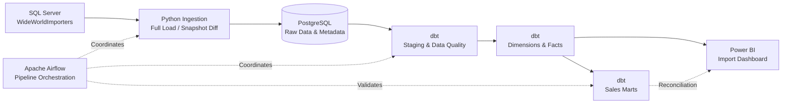

# Retail Data Platform

### End-to-End Retail Analytics with Python, SQL Server, PostgreSQL, dbt, Apache Airflow & Power BI

Retail Data Platform is an end-to-end **batch data engineering project** that transforms operational retail transactions into a structured analytics warehouse and a Power BI sales dashboard. Built using Microsoft's **WideWorldImporters** sample database, it demonstrates the complete journey from source extraction and incremental processing to data modeling, orchestration, data quality, and business reporting.

The project is designed to answer a practical question: **How can a retail business turn transactional data from multiple related tables into reliable, consistent sales insights?**

[Explore the architecture](#architecture) · [View the dashboard](#power-bi-dashboard) · [Try the demo](#quickstart--try-the-demo) · [Explore the code](#repository-guide)

## What the Platform Delivers

| Capability | What it enables |
|---|---|
| **Data ingestion** | Extracts retail data from SQL Server and loads typed records into PostgreSQL, supporting full loads and incremental snapshot comparison. |
| **Data warehouse** | Transforms operational tables into reusable dimensions, facts, and sales-oriented data marts with dbt. |
| **Data quality** | Reconciles source and target records, validates transformation outputs, and protects analytical consistency. |
| **Orchestration** | Coordinates ingestion, version validation, dbt transformations, and downstream checks through an eight-task Airflow DAG. |
| **Business intelligence** | Provides Power BI views of sales performance, product contribution, customer attribution, and reporting exceptions. |
| **Developer experience** | Includes a separate sample-data demo, portable GitHub Actions validation, and documented ingestion benchmarks. |

## Architecture



**How data moves through the platform:**

1. **Extract & load.** Python reads WideWorldImporters source tables using read-only SQL Server access, then writes normalized data to PostgreSQL Raw storage.
2. **Detect changes.** Incremental runs compare six Sales-related source snapshots with a validated parent version and classify records as inserted, updated, or unchanged.
3. **Transform.** dbt organizes the data into staging, quality checks, dimensional models, line-level facts, and five Sales Marts.
4. **Validate.** Counts, content digests, business rules, version checks, and reconciled KPI definitions help keep reporting consistent.
5. **Analyze.** Power BI imports a curated set of warehouse tables for interactive reporting. Airflow orchestrates pipeline execution; dashboard refresh remains a separate manual step.

## Technology Stack

| Layer | Technologies |
|---|---|
| Operational source | Microsoft SQL Server, WideWorldImporters |
| Data ingestion | Python, SQL, pyodbc |
| Raw storage & warehouse | PostgreSQL, Docker |
| Transformation & modeling | dbt, SQL |
| Workflow orchestration | Apache Airflow, WSL2 |
| Analytics & visualization | Power BI, DAX |
| Testing & automation | Python regression tests, dbt data tests, GitHub Actions |

## Project at a Glance

The following figures come from validated project runs and represent different stages of the platform rather than one combined performance benchmark.

| Project result | Value |
|---|---:|
| Source data loaded during initial Full Load | **939,208 records** across 11 objects |
| Sales records evaluated by incremental snapshot comparison | **604,672** across 6 objects |
| Warehouse transformation models | **21 dbt models** |
| Data quality checks in the accepted dbt build | **69 passing dbt tests** |
| Completed orchestration tasks in the accepted Airflow run | **8/8 tasks** |

### Sales Analytics Snapshot

For eligible invoice lines dated **January 2013 through May 2016**, the validated sales model reports:

| KPI | Value |
|---|---:|
| Sales before tax | **172,261,341.20** |
| Invoices | **70,510** |
| Orders | **73,595** |
| Units | **8,950,628** |

Sales before tax follows the project's invoice-line measure definition; no currency or profit interpretation is assumed. See the [metric definitions](dbt/config/measures.yml) and [validation SQL](powerbi/validation.sql).

## Power BI Dashboard

The analytics report focuses on four business perspectives: **sales performance**, **product contribution**, **buyer vs. bill-to attribution**, and **exceptions & coverage**. Four additional detail pages support deeper exploration.

### Sales Performance


### Product Contribution


*The screenshots show a 2014 report filter, not the full-period totals presented above.*

### Business Insights

**1. Invoice volume and sales value can move in different directions.** From January–May 2015 to January–May 2016, invoice count increased **0.90%**, while sales before tax decreased **0.20%**. Average invoice value declined **1.09%**. Reviewing transaction volume alone would miss this change in value per invoice.

**2. Buyer and bill-to customer views answer different questions.** Across the validated 2013–2016 period, the top five buyers account for **1.07%** of sales when attributed by buyer, while the top five bill-to customers account for **63.75%** when attributed by bill-to. The two totals describe different roles for the same invoice sales and must not be added together.

**3. Zero-sales dates should remain visible.** The daily sales mart covers **1,247** calendar dates, including **178** dates with zero invoices and **no missing calendar dates**. Maintaining a complete date series supports accurate time-based comparisons without treating zero activity as missing data.

These findings are backed by [analytical evidence](docs/assets/sales-evidence.json), [SQL reconciliation queries](powerbi/validation.sql), and dbt models. They describe historical sample data, not current retail trading conditions.

## Quickstart — Try the Demo

The repository includes an **isolated sample-data demo** that exercises ingestion, PostgreSQL storage, dbt models, and data quality checks without requiring the original SQL Server instance or private project credentials.

**Prerequisites:** Windows, Python 3.12, Docker Desktop with Linux containers, and Git. See the [demo setup notes](infrastructure/README.md#isolated-portfolio-demo) for environment details.

```powershell
git clone https://github.com/Tphuonggggg/retail-data-platform.git
cd retail-data-platform
py -3.12 -m venv .venv
.venv\Scripts\python.exe -m pip install -r requirements.txt

# Portable repository checks
.venv\Scripts\python.exe scripts/run_checks.py --portable

# Start the isolated pipeline demo
.venv\Scripts\python.exe -m ingestion.demo config
.venv\Scripts\python.exe -m ingestion.demo run

# Shut down only the isolated demo
.venv\Scripts\python.exe -m ingestion.demo down
```

The demo demonstrates initial ingestion, no-change detection, controlled updates/inserts, reconciliation, and dbt results on a small fixture dataset. It is separate from the full WideWorldImporters environment. To reproduce the entire development stack, start with the [infrastructure guide](infrastructure/README.md).

## Repository Guide

| Module | What you'll find |
|---|---|
| [ingestion/](ingestion/README.md) | Full-load and incremental pipelines, source contracts, reconciliation, demo and benchmarks |
| [infrastructure/](infrastructure/README.md) | PostgreSQL setup, Docker configuration, roles and environment provisioning |
| [dbt/](dbt/README.md) | Warehouse models, grains, transformations, data tests and lineage |
| [airflow/](airflow/README.md) | Eight-task DAG, execution, recovery and operational instructions |
| [powerbi/](powerbi/README.md) | Dashboard pages, semantic model, measures and refresh guidance |

### Testing and CI

[](https://github.com/Tphuonggggg/retail-data-platform/actions/workflows/ci.yml)

GitHub Actions runs portable checks on pushes and pull requests. The repository also includes deeper local regression and environment-specific validation. For details, see the module documentation rather than treating the README as a test log.

## Design Choices & Scope

This is a **local batch analytics platform and portfolio project**, not a cloud-hosted production service. A few important boundaries are intentional:

- Incremental ingestion uses **snapshot comparison**, not SQL Server CDC or streaming; unchanged source rows are still scanned.
- The Airflow workflow runs with controlled authorization. Scheduling is prepared, but continuous unattended daily operation is not part of the demonstrated MVP.
- Power BI uses **Import mode and manual refresh**, with an explicit warehouse read-version pin.
- dbt replaces tables individually; the full transformation graph is not an atomic publication transaction.
- The full WideWorldImporters setup depends on local SQL Server, Windows/WSL, ODBC, Docker and Power BI. A clean-machine full-stack installation has not been validated; the isolated demo is intended as the simpler entry point.

## Further Reading

Explore the [ingestion pipeline](ingestion/README.md), [warehouse and lineage](dbt/README.md), [Airflow operations](airflow/README.md), [Power BI implementation](powerbi/README.md), or [PostgreSQL infrastructure](infrastructure/README.md) for implementation details, recovery procedures, and deeper technical validation.
