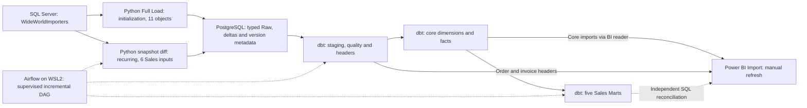

# Retail Data Platform

**End-to-End Batch ELT Pipeline with Python, PostgreSQL, dbt, Apache Airflow and Power BI**

## Project Overview

Retail reporting needs consistent sales totals, customer attribution and product comparisons across operational tables. This local development project turns SQL Server WideWorldImporters data into a reconciled PostgreSQL Sales Warehouse and an interactive Power BI report.

The MVP implements typed Full Load, snapshot-diff incremental ingestion, explicit-version dbt transformations, data quality checks and supervised Airflow orchestration. Sales Analytics is the delivered analytical scope. Inventory tables and temporal archives are captured during Full Load; Inventory Analytics, Purchasing, Finance and complete historical SCD2 are outside the delivered MVP.

## Architecture



Full Load establishes the initial candidate. Incremental runs scan six source tables and compare them with an explicit parent. Airflow coordinates ingestion, dbt and validation; it does not refresh Power BI. The report imports six core/header tables, while marts provide separately reconciled aggregates.

## Tech Stack

| Technology | Purpose | Actual implementation |
|---|---|---|
| SQL Server | Read-only OLTP source | WideWorldImporters on local SQLEXPRESS; Windows Authentication, ODBC Driver 18 |
| Python 3.12 | Extraction, loading and operational checks | pyodbc 5.5.0, psycopg 3.3.9; exact Decimal and temporal codecs |
| PostgreSQL 18 | Raw storage and analytical warehouse | Verified server 18.7; Docker `postgres:18`, isolated `retail_raw` database |
| dbt | SQL transformations and tests | dbt-core 1.11.17 / dbt-postgres 1.11.0; 21 models |
| Apache Airflow 2.11.0 | Local orchestration | Ubuntu WSL2, Python 3.12, SequentialExecutor, SQLite metadata |
| Power BI Desktop | Sales analysis | PBIP/PBIR/TMDL sources, Import model, manual refresh |
| Docker Desktop / WSL2 | Local execution environment | Linux PostgreSQL container; WSL-to-Windows Python bridge |

## Repository Structure

```text
.
├── README.md                      # Project overview and entry points
├── AGENTS.md                      # Collaboration and safety rules
├── requirements.txt               # Pinned Windows Python dependencies
├── .env.example                   # Non-secret configuration template
├── ingestion/
│   ├── full_load.py               # Full Load CLI
│   ├── incremental.py             # Snapshot-diff CLI
│   ├── common/                    # Contracts, types and configuration
│   ├── extractors/                # SQL Server SELECT extraction
│   └── loaders/                   # PostgreSQL persistence and reconciliation
├── infrastructure/
│   ├── docker/compose.raw.yaml
│   ├── postgres/                  # Raw/incremental/warehouse provisioning SQL
│   └── scripts/                   # Connectivity and recovery tools
├── dbt/
│   ├── run_dbt.py                 # Explicit-version runner
│   ├── models/                    # Staging, quality, headers, core and marts
│   ├── macros/                    # Capture, eligibility and measure logic
│   ├── config/                    # Business, measure, quality and performance YAML
│   └── tests/                     # SQL tests and Python regression tests
├── airflow/
│   ├── dags/retail_sales_incremental_pipeline.py
│   ├── bridge.py                  # WSL-to-Windows execution
│   ├── worker.py                  # CLI adapter and validation gates
│   ├── start_local.py             # Guarded scheduler/webserver lifecycle
│   └── schedule_local.py          # One-interval daily schedule planner
├── powerbi/
│   └── RetailSalesAnalytics/      # Active PBIP, Report, SemanticModel and assets
├── scripts/                       # Repository checks
├── tests/                         # Essential contracts and integration verifiers
└── docs/analytics/                # Reusable Sales discovery SQL and analysis code
```

Each of the five modules has one README. Private profiles, extracted data, generated dbt output, Power BI caches and local evidence stay outside Git.

## Data Ingestion

Full Load reads nine current tables and two physical temporal archives. Typed payloads retain source values alongside run/row identity; metadata records scope, status, counts and digests. Archives retain duplicate natural keys and zero-duration history.

Incremental ingestion compares complete snapshots of Customers, Orders, OrderLines, Invoices, InvoiceLines and StockItems with an explicit parent. INSERT/UPDATE write deltas and events; UNCHANGED contributes counters without copying payload. DELETE is tested with consistent isolated fixtures, but live absence detection stops because a coherent source snapshot has not been established. This is **snapshot comparison, not CDC or source-watermark extraction**.

Codecs preserve Decimal, Unicode, binary, NULL versus empty values, and exact SQL Server `datetime2(7)` as 27-character text. Candidate versions are distinct from publication. Successful UUID reuse performs reconciliation/read-back; failed or uncertain writes require durable-state inspection and a fresh identity where appropriate. See [ingestion operations](ingestion/README.md).

## Data Warehouse

Every model is bound to one explicit Full Load run or validated incremental version. The implementation uses observed customer/product labels and retains unresolved historical references; it does not claim complete transaction-time SCD2.

| Schema | Models | Grain within one read version |
|---|---|---|
| `dw_staging` | `stg_sales_customers`, `stg_sales_orders`, `stg_sales_orderlines`, `stg_sales_invoices`, `stg_sales_invoicelines`, `stg_warehouse_stockitems` | Source row |
| `dq` | `validation_violations`, `record_status`, `quarantine_records` | Rule violation, evaluated record, quarantined record |
| `dw_intermediate` | `int_order_header`, `int_invoice_header` | OrderID; InvoiceID |
| `dw_core` | `dim_date`, `dim_customer`, `dim_product` | Calendar date; observed customer; observed product |
| `dw_core` | `fact_order_line`, `fact_invoice_line` | OrderID + OrderLineID; InvoiceLineID |
| `sales_marts` | `mart_sales_daily`, `mart_sales_monthly` | Date; month |
| `sales_marts` | `mart_sales_product_daily` | Invoice date + product |
| `sales_marts` | `mart_customer_sales`, `mart_sales_customer_summary` | Invoice date + customer + role; customer + role |

Dimensions filter facts through observed keys. Buyer and Bill-to are separate roles over the same sales population. Order counts come from Orders, including orders without invoices; invoice counts come from invoice headers. Different fact/mart grains must not be joined to sum sales. See [models and metric contracts](dbt/README.md).

## Orchestration

The `retail_sales_incremental_pipeline` DAG has eight sequential tasks:

```text
preflight_source → preflight_target → run_incremental_ingestion
→ validate_ingestion_batch → resolve_dbt_read_version → run_dbt_build
→ validate_sales_marts → pipeline_complete
```

A manual trigger supplies an explicit parent; its run ID determines the new version UUID. Durable ledger checks, receipts and reconciliations verify that the same version reaches dbt and marts. PostgreSQL advisory locks protect cooperating ingestion/build processes, and `max_active_runs=1` limits DAG overlap. Only transient preflight failures retry automatically; write tasks require inspected recovery.

Scheduling is prepared but disabled by default: manual schedule, paused DAG, `catchup=False`, Asia/Ho_Chi_Minh timezone and a closed write gate. Daily operation requires a future boundary and explicit parent/version/action authorization for **each interval**. Unattended processing across multiple days is not implemented. See [Airflow setup, scheduling and recovery](airflow/README.md).

## Data Quality

- Source-to-Raw checks compare counts, distinct keys, numeric/NULL controls and typed content digests.
- Batch/version checks validate status, lineage, contract, scope and unpublished-candidate state.
- dbt tests cover population accounting, keys, relationships, staging fidelity, eligibility, quarantine, unresolved history and KPI reconciliation.
- Mart gates compare aggregates with independent core/header totals; BI checks reconcile SQL and DAX at the same version and filter scope.

Executable contracts live in [business rules](dbt/config/business_rules.yml), [measures](dbt/config/measures.yml) and [quality rules](dbt/config/quality_rules.yml). Warnings remain eligible where the contract allows; invalid records do not silently contribute. Historical execution results below are separate from checks rerun for documentation.

## Power BI Dashboard

| Main page | Analytical purpose |
|---|---|
| Sales Performance | Sales, invoices, AIV and units; comparable prior-year trends and volume/value decomposition |
| Product Contribution | Product contribution, Top N rankings and Pareto concentration |
| Sales Attribution | Compare Buyer and Bill-to concentration without adding the two role totals |
| Exceptions & Coverage | Negative source LineProfit warnings, activity patterns and date coverage |

Four hidden detail pages support deeper exploration. The Import model has 14 tables, 87 measures and nine single-direction relationships; six tables are imported from PostgreSQL. Refresh is manual and guarded by an explicit read-version pin. See [Power BI connection and usage](powerbi/README.md). The Mermaid diagram presents the flow without adding generated screenshot assets.

## Validated Results

These are results from separate accepted local executions, rechecked against current database/read-version records on **23 November 2026**. They are not one new end-to-end run.

| Result | Verified value | Scope |
|---|---:|---|
| Full Load records | 939,208 | 11 source objects, including archives; accepted initialization run |
| Sales input rows | 604,672 | Six-table state of the validated incremental version |
| Invoiced Sales Before Tax | 172,261,341.20 | Eligible invoice lines, ExtendedPrice minus TaxAmount |
| Invoice Count | 70,510 | Eligible invoice headers, InvoiceDate |
| Order Count | 73,595 | Eligible order headers, OrderDate |
| Source Units Sold | 8,950,628 | Eligible invoice-line Quantity; source packaging units |
| Airflow execution | 8 successful tasks | Accepted supervised run; scheduling remains disabled |
| dbt execution | 21 models, 69 tests passed | Accepted build; documentation checks do not rebuild data |

The analytical calendar covers **2013-01-01 through 2016-05-31**; 2016 contains January–May only. AIV is total Sales Before Tax divided by Invoice Count. These measures do not establish recognized accounting revenue, COGS, net profit or a currency contract. Buyer and Bill-to totals represent the same sales. The current read version is `3a2f011d-f3b3-5683-83a2-a64837720f3d`, validated locally with no publication ACK. [Reproducible BI SQL](powerbi/validation.sql) and the executable measure YAML support reconciliation.

## Getting Started

This is a documented local setup, with manual provisioning checkpoints. A complete cold installation on another machine has not been tested as a single automated workflow.

1. Install Python 3.12, SQL Server with WideWorldImporters, ODBC Driver 18, Docker Desktop Linux Engine, Ubuntu WSL2 and a compatible Power BI Desktop. Airflow uses a separate WSL virtual environment.
2. Clone the repository and create the Windows environment. Replace `<repository-url>` with your repository URL; this local checkout has no configured remote.

   ```powershell
   git clone <repository-url>
   cd project1_Retail_Data_platform
   py -3.12 -m venv .venv
   .venv\Scripts\python.exe -m pip install -r requirements.txt
   Copy-Item .env.example .env
   ```

3. Supply private configuration in `.env`. Obtain and restore WideWorldImporters separately; no source database or credentials are distributed. Review the frozen local source identity guards before porting to another machine. See [infrastructure setup](infrastructure/README.md).
4. Validate Compose, then initialize only a reviewed, new Raw target. Foundation, Full Load, incremental and warehouse provisioning are separate steps. The BI role must exist before the first dbt build; its schema permissions are completed after models exist. Existing targets must be inspected rather than reinitialized.

   ```powershell
   docker compose --env-file .env -f infrastructure/docker/compose.raw.yaml config --quiet
   .venv\Scripts\python.exe -m ingestion.full_load plan --all
   .venv\Scripts\python.exe -m ingestion.full_load preflight --all --env-file .env
   ```

5. On a new, provisioned environment, run the authorized Full Load and reconciliation using a fresh UUID. Configure the transform role/private profile, then debug/compile and explicitly build the same Full Load run. Exact commands and recovery rules are in [ingestion](ingestion/README.md) and [dbt](dbt/README.md). These operations write data and are not validation-only commands.
6. Configure the WSL-to-Windows bridge and start Airflow in manual mode using [Airflow operations](airflow/README.md). Review one incremental run's parent/version/write scope before triggering it.
7. Open the [active PBIP](powerbi/RetailSalesAnalytics/RetailSalesAnalytics.pbip), authenticate as `retail_bi_reader`, verify the serving version and update its pin through the documented workflow if needed. Refresh manually only after a successful, idle warehouse validation.

For offline maintenance checks:

```powershell
.venv\Scripts\python.exe scripts/run_checks.py
```

## Known Limitations

- Local Windows/WSL/Docker setup with machine-specific source and provisioning guards; Airflow SQLite/SequentialExecutor is a development configuration.
- Incremental extraction scans full source snapshots. CDC, source watermarks and proven cross-table snapshot consistency are not implemented; live deletes remain blocked.
- Historical SCD2 lookup and Certified publication remain incomplete. A validated local candidate is not a source-consistent or Certified release.
- The Airflow write gate requires explicit per-run preparation; restart and unattended multi-day scheduling are not guaranteed.
- dbt replaces models individually. The graph is not atomically published, and BI refresh must wait for successful validation.
- Power BI has a fixed six-import version pin and manual refresh. UI click/sync/drill-through acceptance is not complete; structural checks and rendering do not prove every interaction.
- Captured data ends in May 2016. Sales are invoiced measures, units retain source packaging, and currency/financial accounting assumptions must not be invented.

## Next Steps

Improve safe per-interval scheduling, version-aware BI publication, reproducible environment provisioning and operational alerts. These are potential improvements, not delivered functionality.
