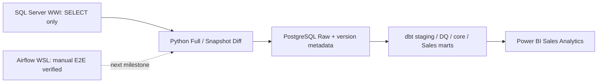

# Retail Data Platform

Đồ án xây dựng Sales Analytics từ WideWorldImporters: bảo toàn dữ liệu nguồn, nạp lặp được, đối soát độc lập và trình bày KPI có grain/date basis rõ ràng.



## Công nghệ và cấu trúc

Python3.12, pyodbc/ODBC18, psycopg3, SQL Server WWI, PostgreSQL18/Docker, dbt-core1.11/dbt-postgres1.11 và Power BI Desktop/PBIP. requirements.txt là dependency manifest; không cài Airflow khi chưa triển khai.

| Module | Trách nhiệm |
|---|---|
| [ingestion](ingestion/README.md) | Source contracts, Full Load, snapshot-diff, reconciliation/recovery |
| [dbt](dbt/README.md) | Staging, DQ, dimensions/facts và Sales marts; business YAML |
| [infrastructure](infrastructure/README.md) | Docker/PostgreSQL, migrations và provisioning/recovery |
| [powerbi](powerbi/README.md) | Active PBIP/TMDL, dashboard, BI access và refresh |
| [airflow](airflow/README.md) | Orchestration tương lai, chưa có DAG |

scripts/ giữ kiểm tra chung; tests/ giữ integration utilities. Các Python/SQL trong docs/analytics vẫn được BI utilities import, không phải tài liệu có thể xóa. Runtime source contract nằm trong ingestion/common/contracts.py; KPI/DQ contract nằm trong dbt/config. AGENTS.md là hướng dẫn cộng tác, không phải README module thứ bảy.

## Quick start

Trên máy mới: cài SQL Server WWI, Python3.12/ODBC18, Docker Desktop Linux Engine và Power BI Desktop. Tạo .venv, cài requirements.txt; nếu chưa có .env thì sao chép .env.example và điền private settings. Không ghi đè .env/.venv hiện có. Provision target theo infrastructure README; dùng quyền phù hợp, không chạy migration trên target sai hoặc đã có objects.

Chỉ khi môi trường chưa tồn tại: `py -3.12 -m venv .venv`, rồi `.venv\Scripts\python.exe -m pip install -r requirements.txt`. Các placeholders `<uuid>` trong README module phải thay bằng run/version thực tế trước khi chạy. Cài đặt môi trường không được thực hiện tự động trong cleanup này.

```powershell
.venv\Scripts\python.exe -m ingestion.full_load --help
.venv\Scripts\python.exe -m ingestion.incremental --help
docker compose --env-file .env -f infrastructure/docker/compose.raw.yaml config --quiet
.venv\Scripts\python.exe scripts/run_checks.py
```

## Workflow và giới hạn

Plan → source/target preflight → run được cho phép → reconcile → chọn explicit capture/version cho dbt → DQ → warehouse/marts → Power BI refresh. Không tự publish, chọn latest hoặc advance checkpoint từ một run chưa đối soát.

Sales Full/Incremental và dbt/DQ đã có implementation; incremental quét toàn bộ sáu nguồn Sales để snapshot-diff, không phải CDC. Source consistency vẫn chưa được chứng minh bằng coherent atomic snapshot. Historical SCD2 chưa được triển khai đầy đủ; observed-current labels không thay historical attribution. Customer/Product hiện là dimensions Sales; Inventory/Customer analytics độc lập, Purchasing/Finance/BigQuery là mở rộng.

Dashboard có bốn trang chính và bốn detail ẩn; DAX đã đối soát, nhưng click/sync/reset/drill-through UI acceptance chưa đầy đủ. Serving local không được gọi Certified/atomic publication. Airflow đã chạy một supervised local DAG thành công; write gate đã tắt và DAG paused. Serving version hiện 3a2f011d-f3b3-5683-83a2-a64837720f3d; Power BI vẫn pin version cũ, cần review riêng trước manual refresh, không bỏ version guard.

Không commit credentials, source extracts hoặc .local/.pbi caches. Không chạy load/build/migrations chỉ để kiểm tra tài liệu.
