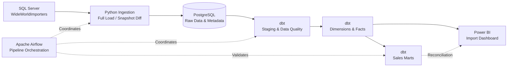
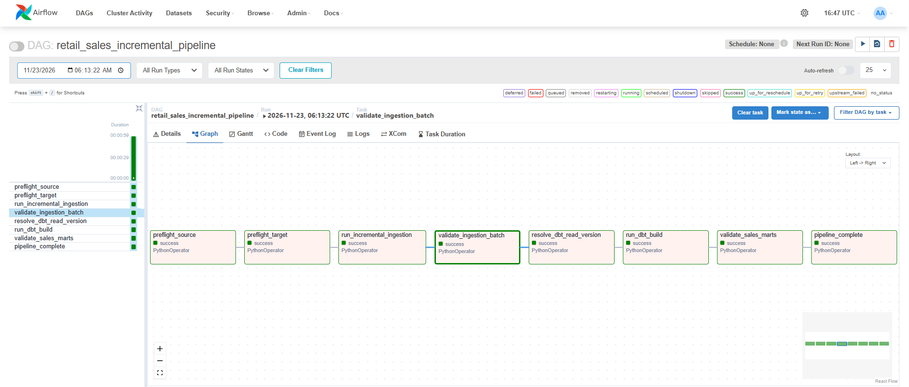
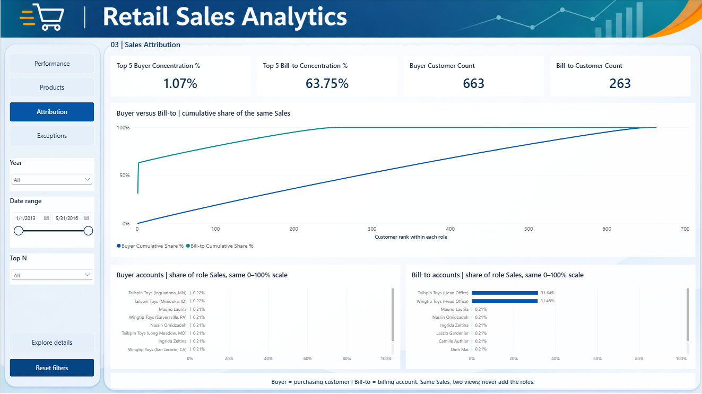
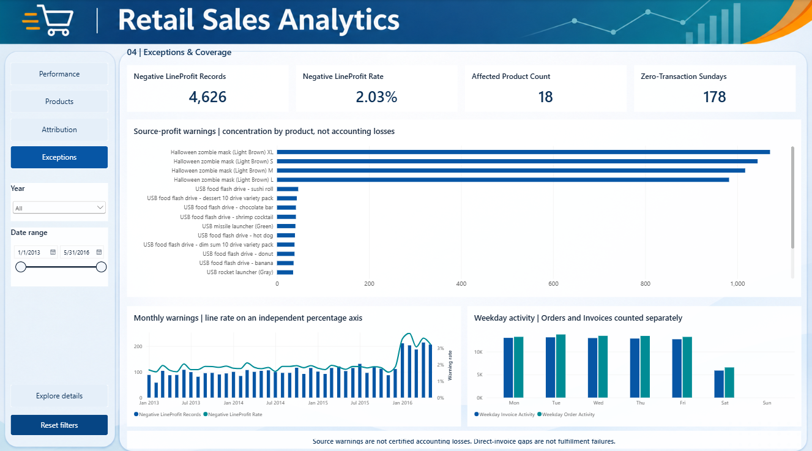

# Retail Data Platform

Batch retail analytics with Python, SQL Server, PostgreSQL, dbt, Apache Airflow and Power BI.

## Overview

Retail Data Platform turns operational retail transactions into a reconciled Data Warehouse and a Power BI sales dashboard. It uses Microsoft's WideWorldImporters sample database to connect source extraction, Incremental Loading, dimensional modeling and business reporting in a local batch ELT workflow.

The platform addresses a common reporting problem: orders, invoices and line items have different grains, while buyers and bill-to accounts describe different roles in the same sale. Explicit Read Versions, Data Quality rules and shared measure definitions keep these populations consistent across SQL and Power BI.

[Architecture](#architecture) · [Dashboard](#analytics-dashboard) · [Demo](#getting-started) · [Module documentation](#project-structure)

## Features

- Full Load initialization and Snapshot-Diff Incremental Loading with an explicit parent version.
- Typed Raw Layer storage, content digests, transactional deltas and idempotent version reuse.
- A dbt Data Warehouse with Staging Models, Data Quality, Dimensions, Facts and five Sales Marts.
- An eight-task Airflow DAG with version handoff, scoped write authorization and controlled recovery.
- Power BI Import analytics for sales, product contribution, customer attribution and reporting exceptions.
- An isolated sample-data demo, repeatable fixture benchmarks and portable regression checks.

## Architecture



Full Load initializes the Raw Layer from 11 source objects, including temporal archives. Incremental Loading scans six Sales-related inputs, compares them with a validated parent and stores INSERT/UPDATE deltas. Both paths retain counts, typed content digests and lineage metadata.

dbt reads one explicit version and builds the analytical layers. Power BI imports six core/header tables; Sales Marts provide independent SQL aggregates for reconciliation. Airflow coordinates ingestion, transformations and validation. Manual Refresh remains separate from orchestration.

## Technology Stack

| Layer | Technology and responsibility |
|---|---|
| Source | SQL Server WideWorldImporters; SELECT-only Windows Authentication through ODBC Driver 18 |
| Ingestion | Python 3.12, pyodbc and psycopg; extraction, codecs, versioning and reconciliation |
| Storage | PostgreSQL 18 in Docker; Raw Layer, metadata and analytical schemas |
| Transformation | dbt-core/dbt-postgres; SQL models and Data Quality tests |
| Orchestration | Apache Airflow 2.11.0 on Ubuntu WSL2; Windows Python bridge |
| Analytics | Power BI Desktop, Import semantic model and DAX |
| Development | unittest, GitHub Actions and offline documentation checks |

## Data Warehouse

The production dbt project contains 21 models: six Staging Models, three Data Quality models, two intermediate headers, three Dimensions, two line-level Facts and five Sales Marts.

Order and invoice headers retain independent business populations. Facts preserve order-line and invoice-line grain; marts summarize sales by day, month, product and customer role. Buyer and Bill-to attribution describe the same invoice sales and are never additive across roles. Customer and product labels reflect observed source attributes rather than complete historical SCD Type 2 lookup.


Upstream dependencies of `mart_sales_monthly`, from six Raw sources through staging, quality, headers and core models. The image shows this model's dependency subset; the [Data Warehouse guide](dbt/README.md#data-lineage) contains the full dependency graph and model grains.

## Pipeline Orchestration

The `retail_sales_incremental_pipeline` DAG connects source/target preflight, Incremental Loading, batch validation, Read Version resolution, dbt transformations and Sales Mart verification. Each task checks the upstream parent/version handoff. Recovery can rebuild the dbt tail while retaining successful ingestion.



Eight dependent tasks shown in a completed reference run. The DAG defaults to a manual schedule, paused state and a closed write gate. See the [orchestration guide](airflow/README.md) for execution and recovery.

## Analytics Dashboard

The report answers four groups of business questions:

- Sales Performance: how sales, invoice activity and average invoice value change over comparable periods.
- Product Contribution: which products contribute sales and units, and how concentrated those contributions are.
- Sales Attribution: how Buyer and Bill-to roles change the view of customer concentration.
- Exceptions & Coverage: where source warnings and zero-activity dates affect interpretation.

The overview screenshots cover the full dataset, January 2013–May 2016, with Year set to All and no date-range restriction. Where available, Top N and Product selection are also set to All.

### Sales Performance


Full-period sales, invoice activity, average invoice value and units, with monthly trends and comparable prior-year sales.

### Product Contribution


Product sales concentration, the Pareto distribution and rankings by sales and source units across all products.

### Sales Attribution



Buyer and Bill-to concentration compare two views of the same sales population; role totals are not additive.

### Exceptions & Coverage



Source LineProfit warnings by product and month, alongside weekday order/invoice activity and zero-transaction Sundays. Source warnings do not establish accounting losses.

Four additional detail pages support exploration. The [Power BI guide](powerbi/README.md) describes measures, filters and Manual Refresh.

## Business Insights

The following insights use the reference dataset from January 2013 through May 2016.

1. **Invoice volume does not explain sales value alone.** Comparing January–May 2016 with January–May 2015, invoice count increased 0.90%, sales before tax decreased 0.20% and average invoice value declined 1.09%. Monitoring volume alongside value per invoice gives a more complete view; the calendar windows include an extra leap day in 2016.
2. **Customer concentration depends on attribution.** The top five Buyers account for 1.07% of sales, while the top five Bill-to accounts represent 63.75%. Bill-to concentration supports a different account-management question from Buyer activity; the two role totals represent the same sales.
3. **Zero activity belongs in the calendar.** The daily mart contains 1,247 continuous dates, including 178 dates with zero invoices and no missing calendar dates. Keeping these dates supports time comparisons without equating zero activity with missing data.

[Aggregate evidence](docs/assets/sales-evidence.json) and [SQL queries](powerbi/validation.sql) document the populations and calculations. These findings describe sample data, not current retail trading conditions.

## Project Highlights

Reference executions loaded 939,208 records across 11 source objects and examined a six-object Sales state of 604,672 rows. The project defines 21 production dbt models, 69 data tests and an eight-task Airflow graph.

| Reference Sales metric | January 2013–May 2016 |
|---|---:|
| Sales Before Tax | 172,261,341.20 |
| Invoice Count | 70,510 |
| Order Count | 73,595 |
| Source Units Sold | 8,950,628 |

Sales Before Tax sums `ExtendedPrice - TaxAmount` on eligible invoice lines by InvoiceDate. Orders use OrderDate, and source units retain their packaging definitions. The project does not assign a currency or interpret these measures as recognized revenue, COGS or net profit. See the [measure contract](dbt/config/measures.yml).

## Getting Started

The isolated demo uses synthetic data and a separate PostgreSQL container. It requires Windows, Python 3.12, Git and Docker Desktop with Linux containers; it does not need SQL Server or private project credentials.

```powershell
git clone https://github.com/Tphuonggggg/retail-data-platform.git
cd retail-data-platform
py -3.12 -m venv .venv
.venv\Scripts\python.exe -m pip install -r requirements.txt

# Portable repository checks
.venv\Scripts\python.exe scripts/run_checks.py --portable

# Start the isolated pipeline demo
.venv\Scripts\python.exe -m ingestion.demo config
.venv\Scripts\python.exe -m ingestion.demo run

# Shut down only the isolated demo
.venv\Scripts\python.exe -m ingestion.demo down
```

The demo exercises initial ingestion, no-change detection, controlled INSERT/UPDATE, reconciliation, rollback/recovery and two separate dbt demo models with seven data tests. Its output is independent of the production warehouse. See [demo configuration](infrastructure/README.md#demo-environment) and [sample behavior](ingestion/README.md#sample-demo).

The full environment additionally requires WideWorldImporters, Windows Authentication/ODBC, WSL Airflow and Power BI Desktop. Start with the [environment setup guide](infrastructure/README.md).

## Project Structure

| Module | Contents |
|---|---|
| [ingestion](ingestion/README.md) | Full Load, Incremental Loading, codecs, reconciliation, demo and benchmarks |
| [infrastructure](infrastructure/README.md) | Docker, PostgreSQL provisioning, credentials and persistence |
| [dbt](dbt/README.md) | Data Warehouse models, grains, measures, Data Quality and Data Lineage |
| [airflow](airflow/README.md) | Task graph, configuration, execution, scheduling and recovery |
| [powerbi](powerbi/README.md) | Semantic model, dashboard pages, DAX and Manual Refresh |

[](https://github.com/Tphuonggggg/retail-data-platform/actions/workflows/ci.yml)

GitHub Actions runs portable regression checks, Compose configuration validation and offline dbt documentation checks on pushes and pull requests. Desktop-dependent Power BI structural checks remain part of the full local suite.

## Design Decisions & Limitations

- Snapshot-Diff reduces written payload but still scans the complete source and parent state. CDC, streaming and coherent cross-table source snapshots are outside the implementation; live DELETE detection remains blocked.
- Read Version validation identifies a candidate, not Certified publication. Historical SCD Type 2 lookup and Certified coverage remain future work.
- Airflow requires explicit authorization for each parent/version/action scope. Unattended daily operation and automatic restart/reboot recovery are not guaranteed.
- dbt replaces relations individually rather than publishing an atomic graph. Power BI Import uses a fixed Read Version pin and Manual Refresh after the graph validates.
- The full stack uses local Windows/WSL/Docker services and machine-specific source guards. Complete installation on a clean machine is not yet validated; the demo provides a smaller entry point.
- Sales Analytics is the delivered analytical scope. Inventory, Purchasing and Finance analytics remain outside the MVP.

## Further Reading

Continue with [ingestion design](ingestion/README.md), [warehouse modeling](dbt/README.md), [Airflow operations](airflow/README.md), [dashboard usage](powerbi/README.md) or [database infrastructure](infrastructure/README.md).
