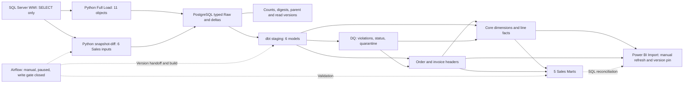
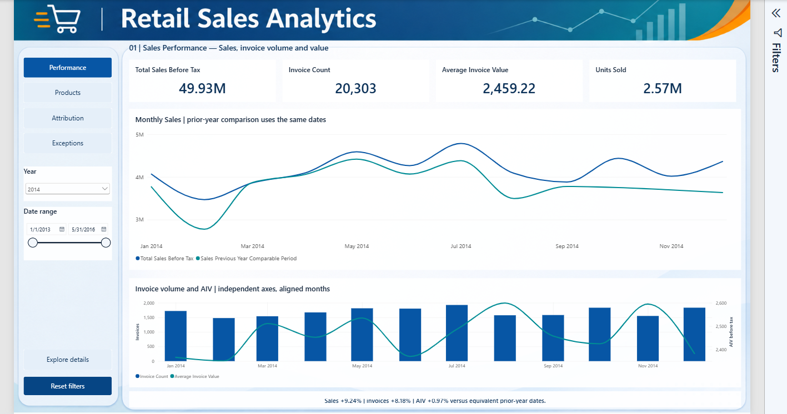
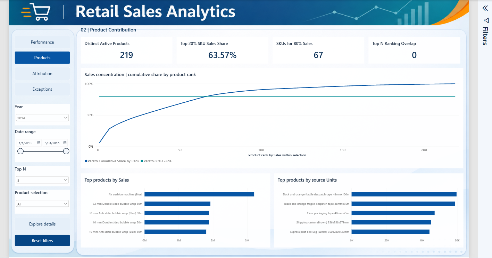

# Retail Data Platform

**Batch ELT portfolio: Python → PostgreSQL → dbt → Power BI, điều phối bằng Apache Airflow.**

[](https://github.com/Tphuonggggg/retail-data-platform/actions/workflows/ci.yml)

Badge trỏ đến workflow thật; GitHub-hosted execution hiện **NOT_RUN**, chưa xác nhận CI xanh.

## Project Overview

Dự án Data Engineering cấp Internship/Fresher chuyển dữ liệu WideWorldImporters từ SQL Server sang Sales Warehouse có đối soát và dashboard Power BI. Phạm vi MVP đã triển khai là Sales Analytics trên môi trường local Windows/WSL/Docker. Có demo riêng bằng dữ liệu tổng hợp để trải nghiệm mà không cần SQL Server hay cấu hình cá nhân.

## Business Problem

Các bảng Orders, Invoices và dòng hàng có grain khác nhau; cộng trực tiếp dễ nhân đôi doanh số. Buyer và Bill-to là hai góc quy thuộc của cùng giao dịch. Pipeline giữ ranh giới này, kiểm tra chất lượng và read version để báo cáo doanh số, sản phẩm và khách hàng có thể đối soát với SQL.

## Architecture



Power BI import sáu bảng core/header; marts phục vụ đối soát SQL riêng. Airflow không refresh Power BI. Metadata ghi candidate đã kiểm tra, chưa phải publication ACK. DQ kiểm tra source→Raw bằng count/digest, sau đó kiểm tra staging/eligibility và KPI ở dbt/marts.

## Key Features

- Full Load có typed codecs, Decimal/NULL/Unicode và `datetime2(7)` chính xác 100 ns.
- Incremental snapshot-diff với parent tường minh, transaction, read-back reconciliation và idempotency; không phải CDC.
- 21 dbt models: staging → DQ/header → dimensions/facts → Sales Marts; mô tả grain và lineage có kiểm tra.
- DAG tám task, write gate theo đúng parent/version/action, advisory locks và recovery phần đuôi dbt mà không extract lại.
- Power BI có bốn trang chính, bốn trang chi tiết; Import và refresh thủ công.
- CI offline, demo PostgreSQL riêng, benchmark fixture lặp lại được; không cần WWI để chạy demo.

## Validated Project Results

**Bằng chứng lịch sử accepted**, được đối chiếu từ hồ sơ local ngày 23/11/2026; không phải một lần chạy E2E mới:

| Kết quả | Giá trị | Phạm vi |
|---|---:|---|
| Full Load | 939,208 rows / 11 objects | Bao gồm hai archives |
| Incremental Sales state | 604,672 rows / 6 objects | Snapshot đã đối soát |
| dbt | 21 models / 69 data tests PASS | Accepted build lịch sử |
| Airflow | 8/8 tasks SUCCESS | Supervised run, không chứng minh daily tự động |
| Sales Before Tax | 172,261,341.20 | Eligible invoice lines, 2013-01-01–2016-05-31 |
| Invoices / Orders / Source units | 70,510 / 73,595 / 8,950,628 | Grain/date basis theo measure contract |

[Số liệu phân tích công khai](docs/assets/sales-evidence.json), [SQL đối soát](powerbi/validation.sql) và [định nghĩa KPI](dbt/config/measures.yml). Không tự gán currency, recognized revenue, COGS hay net profit.

**Kiểm tra mới trong lượt này:** demo cô lập PASS (2 dbt models, 7 tests, rollback/recovery và expected output); benchmark fixture đã đo thật. Kết quả này không chứng minh full-stack chạy trên máy sạch. Chi tiết lệnh và giới hạn nằm trong module READMEs.

## Dashboard Preview

Ảnh thật đã lưu trong bằng chứng Power BI version-sync, tái sử dụng nguyên byte; đang lọc **năm 2014**, không phải tổng toàn kỳ. [Nguồn và SHA256](docs/assets/provenance.json).





Chưa tìm thấy ảnh Airflow Graph View hoặc dbt test execution phù hợp để xuất bản. Xem [hướng dẫn chụp Airflow](airflow/README.md#portfolio-evidence) và [dbt](dbt/README.md#portfolio-validation); không tạo ảnh runtime giả.

## Business Insights

Ba nhận định dưới đây dùng cùng read version lịch sử trong [evidence JSON](docs/assets/sales-evidence.json). Sales = Σ(ExtendedPrice − TaxAmount) trên eligible invoice lines theo InvoiceDate.

| Câu hỏi | Kết quả, kỳ và định nghĩa | SQL/model | Ý nghĩa thực tế |
|---|---|---|---|
| Tăng số invoice có luôn tăng Sales? | Jan–May 2016 so Jan–May 2015: Sales 22,633,175.55 so 22,679,145.45 (**−0.20%**); invoices 9,190 so 9,108 (**+0.90%**); AIV=Sales/invoices **−1.09%**. 2016 có thêm leap day. | `powerbi/validation.sql` Q05; `mart_sales_daily`, invoice headers | Theo dõi cả volume và giá trị invoice; đây là phân rã số học, chưa chỉ ra nguyên nhân. |
| Rủi ro tập trung nằm ở Buyer hay Bill-to? | 2013-01-01–2016-05-31: 663 Buyers, 263 Bill-to; Top 5 chiếm **1.07%** và **63.75%** Sales theo từng role; tổng mỗi role cùng là 172,261,341.20. | Q08/Q09; `fact_invoice_line`, `int_invoice_header` | Đánh giá tập trung thu tiền theo Bill-to riêng với phân bổ hoạt động Buyer; không cộng hai tổng role. |
| Các ngày không có invoice có phải thiếu lịch? | Cùng kỳ: **1,247** ngày lịch liên tục, **178** ngày zero invoices, **0** ngày thiếu trong daily mart. | Q02; `dim_date`, `mart_sales_daily` | Giữ zero-activity days trong mẫu số so sánh; zero activity chưa chứng minh thiếu extract hoặc doanh nghiệp đóng cửa. |

## Quickstart

Python **3.12** và Docker Desktop Linux Engine đủ cho demo; full environment cần SQL Server WWI, ODBC Driver 18, WSL Airflow và Power BI Desktop.

```powershell
git clone https://github.com/Tphuonggggg/retail-data-platform.git
cd retail-data-platform
py -3.12 -m venv .venv
.venv\Scripts\python.exe -m pip install -r requirements.txt
.venv\Scripts\python.exe scripts/run_checks.py --portable
.venv\Scripts\python.exe -m ingestion.demo config
.venv\Scripts\python.exe -m ingestion.demo run
# Chỉ dừng demo riêng; dữ liệu tmpfs của demo mất khi dừng.
.venv\Scripts\python.exe -m ingestion.demo down
```

Clone mặc định tạo `retail-data-platform`. Checkout hiện tại có tên thư mục khác vì đã được đặt tên riêng; không dùng tên checkout riêng trong hướng dẫn clone. Demo tự sinh credentials riêng trong `.local/portfolio-demo`, không đọc `.env`. Xem [demo/isolation](infrastructure/README.md#isolated-portfolio-demo) và [demo/benchmark](ingestion/README.md#portfolio-demo).

Full setup và provisioning có checkpoint thủ công: bắt đầu từ [infrastructure](infrastructure/README.md), rồi [ingestion](ingestion/README.md), [dbt](dbt/README.md), [Airflow](airflow/README.md) và [Power BI](powerbi/README.md). Không chạy Full/Incremental/build trên dữ liệu hiện hữu chỉ để kiểm tra tài liệu.

## Technical Documentation Links

| Module | Nội dung |
|---|---|
| [ingestion](ingestion/README.md) | Source contract, load, recovery, demo và benchmark |
| [infrastructure](infrastructure/README.md) | Compose, provisioning, permissions, demo isolation |
| [dbt](dbt/README.md) | Models/grains, metrics, DQ, lineage và non-atomic replacement |
| [airflow](airflow/README.md) | Tám task, write gate, retry, supervised recovery và lịch manual |
| [powerbi](powerbi/README.md) | Import model, DAX, version pin và manual refresh |

Kiểm tra local đầy đủ: `python scripts/run_checks.py` (Power BI structural suite cần Windows/Desktop TOM). CI: `python scripts/run_checks.py --portable` và `python scripts/validate_portfolio.py`; không dùng SQL Server/PostgreSQL/Power BI/WSL. Không bỏ qua failure; Power BI suite ngoài phạm vi CI được ghi rõ NOT_RUN. Thay đổi chỉ được commit local trên feature branch, không tự push/merge.

GitHub Description đề xuất: `Local retail batch ELT with Python, PostgreSQL, dbt, Airflow and Power BI; reconciled Sales analytics, isolated demo and offline CI.` Topics: `data-engineering`, `portfolio`, `python`, `postgresql`, `dbt`, `apache-airflow`, `powerbi`, `elt`, `wideworldimporters`. Đây là đề xuất; chưa sửa GitHub settings.

## Limitations and Future Improvements

- Local Windows/WSL/Docker; full environment cần WWI được restore riêng và review machine-specific guards. Chưa kiểm chứng clean-machine full stack.
- Snapshot-diff vẫn scan toàn source khi không đổi. Chưa có CDC/watermark hoặc coherent cross-table snapshot; live DELETE bị chặn.
- Historical SCD2/Certified publication chưa hoàn tất; validated candidate không tương đương ACK/publication.
- DAG mặc định paused, schedule=None và write gate=false. Chưa chứng minh unattended daily; mỗi interval cần scope riêng.
- dbt thay từng relation, graph không atomic; không refresh BI trong lúc build/recovery.
- Power BI refresh thủ công, pin cố định ở sáu imports; UI interaction acceptance chưa hoàn tất. Không tự đổi semantic model hoặc layout.
- Demo dùng fixture nhỏ và adapter riêng, tái dùng production comparator/codecs; không kiểm chứng toàn production ingestion metadata/SQL Server adapter. Benchmark là in-memory fixture, không phải DB/production throughput.
- Dữ liệu WWI kết thúc tháng 5/2016; so sánh năm cần coverage tương đương. Inventory/Purchasing/Finance Analytics nằm ngoài MVP.
