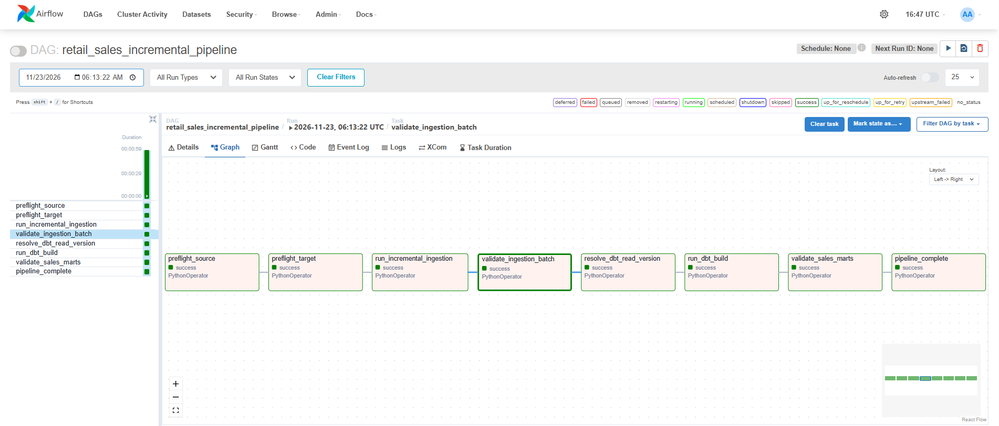

# Airflow Pipeline Orchestration

## Overview

Airflow coordinates Snapshot-Diff Incremental Loading, Read Version validation, dbt transformations and Sales Mart verification. It calls the existing ingestion/dbt CLIs rather than reimplementing their behavior. Publication pointers and Power BI Manual Refresh remain outside the DAG.

See [ingestion](../ingestion/README.md) for extraction semantics, [dbt](../dbt/README.md) for model replacement and [infrastructure](../infrastructure/README.md) for database setup.

## Workflow Architecture

Airflow 2.11.0 runs with Python 3.12 in Ubuntu WSL2, using SequentialExecutor and SQLite metadata at `~/airflow/airflow.db`. [start_local.py](start_local.py) manages scheduler/webserver processes; the UI binds to `127.0.0.1:8080`.

[bridge.py](bridge.py) launches Windows `.venv/Scripts/python.exe` and [worker.py](worker.py) through an explicit argument list and working directory. Windows Authentication and SQL Server ODBC access therefore stay in Windows. The bridge does not interpolate shell commands or require WSL ODBC. XCom contains only small action/status/parent/version metadata, without passwords.

## DAG Overview



The `retail_sales_incremental_pipeline` graph shows eight tasks in a completed reference run. Manual scheduling remains the default.

| Task | Responsibility |
|---|---|
| `preflight_source` | SELECT, projection and source-security checks for the six Sales dependencies |
| `preflight_target` | Target identity, schema, privileges and explicit parent eligibility |
| `run_incremental_ingestion` | Existing incremental CLI with a deterministic version UUID derived from the exact run ID |
| `validate_ingestion_batch` | Durable VALIDATED state, parent/contract/algorithm/scope, ACK=NULL and six-object reconciliation |
| `resolve_dbt_read_version` | Handoff of that same validated UUID without parent/latest fallback |
| `run_dbt_build` | Sales graph build with command/input/version receipt and model/data-test checks |
| `validate_sales_marts` | Five nonempty, consistently pinned marts reconciled against core/header totals |
| `pipeline_complete` | Final version/mart checks, without publication, ACK or BI refresh |

## Task Dependencies

```text
preflight_source → preflight_target → run_incremental_ingestion
→ validate_ingestion_batch → resolve_dbt_read_version → run_dbt_build
→ validate_sales_marts → pipeline_complete
```

Each dependency uses `all_success`. A failed upstream check blocks downstream completion rather than allowing a partial pipeline to appear complete.

## Execution Model

The DAG defaults to `schedule=None`, `catchup=False`, `max_active_runs=1`, timezone `Asia/Ho_Chi_Minh` and paused upon creation. The private execution profile starts with `allow_pipeline_writes=false` and `write_scope=null`. Paused-upon-creation does not re-pause an existing DAG after a reboot.

Manual configuration supplies canonical `parent_version`. Scheduled runs without conf use an explicit environment parent. A new exact run ID determines a new version UUID, including when extraction finds no changes. The current Power BI pin does not change automatically.

## Configuration

### Airflow installation

Use a separate Python 3.12 WSL virtual environment. For a new installation, follow the [Airflow 2.11 constrained package installation](https://airflow.apache.org/docs/apache-airflow/2.11.0/installation/installing-from-pypi.html):

```bash
# First installation only: do not run against the existing environment/metadata.
test ! -e ~/airflow_env && python3.12 -m venv ~/airflow_env
~/airflow_env/bin/python -m pip install 'apache-airflow==2.11.0' \
  --constraint https://raw.githubusercontent.com/apache/airflow/constraints-2.11.0/constraints-3.12.txt
~/airflow_env/bin/python -m pip check
export AIRFLOW_HOME="$HOME/airflow"
export AIRFLOW__CORE__EXECUTOR=SequentialExecutor
export AIRFLOW__CORE__LOAD_EXAMPLES=False
export AIRFLOW__CORE__DAGS_ARE_PAUSED_AT_CREATION=True
~/airflow_env/bin/airflow db migrate
~/airflow_env/bin/airflow users create --help
```

Create the UI account with `airflow users create`, supplying username/contact fields and entering its password interactively. Preserve the executor, disabled examples and paused-at-creation settings in configuration/startup. The launcher does not initialize, migrate or reset metadata or create credentials. Reuse an existing installation without reinstalling packages or replacing `airflow.cfg`.

### Bridge profile

Adapt all four path fields in [config.example.json](config.example.json) to the Windows/WSL checkout. Keep the gate closed and scope NULL during setup; database credentials belong to the component configuration, not the bridge profile.

```bash
cd /mnt/d/Code/Retail_Data_Platform/project1_Retail_Data_platform
mkdir -p ~/.config/retail-airflow ~/airflow/dags
test -e ~/.config/retail-airflow/config.json || cp airflow/config.example.json ~/.config/retail-airflow/config.json
chmod 600 ~/.config/retail-airflow/config.json
# Create only when the link name is unused; inspect a broken/existing link first.
test -e ~/airflow/dags/retail_sales_incremental_pipeline.py || ln -s "$PWD/airflow/dags/retail_sales_incremental_pipeline.py" ~/airflow/dags/retail_sales_incremental_pipeline.py
export RETAIL_AIRFLOW_CONFIG="$HOME/.config/retail-airflow/config.json"
export RETAIL_AIRFLOW_SCHEDULE=manual
unset RETAIL_AIRFLOW_DAILY_TIME RETAIL_AIRFLOW_SCHEDULE_PARENT RETAIL_AIRFLOW_SCHEDULE_NOT_BEFORE
~/airflow_env/bin/airflow version
~/airflow_env/bin/airflow db check
~/airflow_env/bin/airflow dags list-import-errors --output json
```

Inspect an existing or broken DAG symlink before creating another. Run repository-relative commands from the WSL checkout; the path above is the original layout and must match the actual installation.

## Starting Airflow

Start SQL Server with its configured identity/TLS settings and Docker Desktop with Linux containers. Inspect the existing Raw container, its dedicated volume and loopback binding before starting it:

```powershell
docker context show
docker info --format '{{.OSType}}'
docker inspect retail-raw-postgres-1 --format '{{.Config.Image}} {{json .Mounts}} {{json .HostConfig.PortBindings}}'
# Only after confirming the dedicated volume and localhost:55434 binding:
docker start retail-raw-postgres-1
docker inspect retail-raw-postgres-1 --format '{{.State.Health.Status}}'
wsl -d Ubuntu
```

In the configured WSL shell:

```bash
~/airflow_env/bin/python airflow/start_local.py --status
~/airflow_env/bin/python airflow/start_local.py --start
curl --fail http://127.0.0.1:8080/health
~/airflow_env/bin/airflow dags list-import-errors --output json
~/airflow_env/bin/airflow dags list-runs -d retail_sales_incremental_pipeline
```

Startup/restart requires a paused DAG, no queued/running execution and a closed gate/scope. If reboot leaves execution armed, pause/close it before startup. `--start` is idempotent for matching process identity/configuration only. The launcher checks PID command, UID/process group, profile path and inherited schedule environment, and puts `airflow_env/bin` on service/subprocess PATH for SequentialExecutor's bare `airflow` invocation.

Service logs/PIDs are in `~/airflow/retail-service-logs`; task logs are under Airflow home and available in the UI. Windows logon context and WSL must remain available. No autostart service, Windows Task Scheduler integration or automatic Docker restart is configured.

## Manual Execution

Execution requires an explicit, version-scoped write authorization. Before arming a run, inspect source/target identity, TLS, selected-object preflight, parent eligibility/chain depth, durable metadata baseline, active CLI/Windows children and the dbt replacement scope. Source snapshot consistency remains unproven even when these checks succeed.

Use a fresh exact run ID and a verified parent. The bridge derives the version; the private profile then authorizes only that parent/version and the necessary actions:

```bash
export PARENT=3a2f011d-f3b3-5683-83a2-a64837720f3d  # Revalidate before using.
export RUN_ID="manual__supervised_$(date -u +%Y%m%dT%H%M%SZ)"
./.venv/Scripts/python.exe -X utf8 -m ingestion.incremental preflight --parent-id "$PARENT"
~/airflow_env/bin/python - <<'PY'
import json,os,sys
from pathlib import Path
sys.path.insert(0,str(Path.cwd()/'airflow'))
from bridge import version_for_run
f=Path(os.environ['RETAIL_AIRFLOW_CONFIG']);c=json.loads(f.read_text())
assert c.get('allow_pipeline_writes') is False and c.get('write_scope') is None
v=str(version_for_run(os.environ['RUN_ID']))
c.update(allow_pipeline_writes=True,write_scope={'parent':os.environ['PARENT'],'version':v,'actions':['ingest','build']})
f.write_text(json.dumps(c,indent=2)+'\n')
print('Armed exact run version:',v)
PY
~/airflow_env/bin/airflow dags unpause retail_sales_incremental_pipeline
~/airflow_env/bin/airflow dags trigger retail_sales_incremental_pipeline \
  --run-id "$RUN_ID" --conf "{\"parent_version\":\"$PARENT\"}"
~/airflow_env/bin/airflow dags list-runs -d retail_sales_incremental_pipeline
```

Both bridge and worker enforce the exact scope; the boolean alone is insufficient. Scope includes incremental delta/events/version and Sales transformation writes, never SQL Server writes, publication or BI refresh. After success or failure, pause the DAG, drain activity and close the gate using [shutdown](#shutdown).

## Scheduling

Manual operation is the default. [scheduling.py](scheduling.py) reads only non-secret parse-time settings:

| Variable | Meaning |
|---|---|
| `RETAIL_AIRFLOW_SCHEDULE` | `manual` or `daily`; default `manual` |
| `RETAIL_AIRFLOW_DAILY_TIME` | HH:MM; default 02:00 in Asia/Ho_Chi_Minh |
| `RETAIL_AIRFLOW_SCHEDULE_PARENT` | Explicit eligible parent UUID |
| `RETAIL_AIRFLOW_SCHEDULE_NOT_BEFORE` | Future +07:00 timestamp at the selected daily boundary |

Daily mode uses CronTriggerTimetable, not an extraction date window. `catchup=False` prevents historical backfill, but a latest missed interval may still be considered after downtime; its distinct UUID remains blocked without a matching scope.

### Prepare one interval

With the DAG paused/drained and the gate closed, generate a single-interval plan for an authorized future boundary:

```bash
PARENT=3a2f011d-f3b3-5683-83a2-a64837720f3d  # Verify actual parent again.
export RETAIL_OWNER_PLAN=".local/airflow-owner-$(date +%Y%m%dT%H%M%S).json"
ENV_PLAN="${RETAIL_OWNER_PLAN%.json}.env"
~/airflow_env/bin/python airflow/schedule_local.py --parent "$PARENT" --daily-time 02:00 \
  --output "$RETAIL_OWNER_PLAN" --env-output "$ENV_PLAN"
cat "$RETAIL_OWNER_PLAN"
# Review future boundary, exact run ID, version and ingest/build scope.
~/airflow_env/bin/python airflow/start_local.py --stop
source "$ENV_PLAN"
~/airflow_env/bin/python airflow/start_local.py --start
curl --fail http://127.0.0.1:8080/health
~/airflow_env/bin/airflow dags list-import-errors --output json
~/airflow_env/bin/python airflow/start_local.py --status
./.venv/Scripts/python.exe -X utf8 -m ingestion.incremental preflight --parent-id "$PARENT"
```

The planner does not connect to SQL, arm writes or trigger execution. It derives the run ID from scheduler UTC normalization; using a differently formatted local-time string can produce a different UUID. Review the plan and stop with the DAG paused/gate closed if any import, health or preflight check fails.

### Authorize the planned interval

Recompute and compare the exact environment, run ID and scope before arming that one interval:

```bash
~/airflow_env/bin/python - <<'PY'
import os,json,sys
from pathlib import Path
sys.path.insert(0,str(Path.cwd()/'airflow'))
from schedule_local import plan
p=json.loads(Path(os.environ['RETAIL_OWNER_PLAN']).read_text());e=p['environment']
v=plan(e['RETAIL_AIRFLOW_DAILY_TIME'],e['RETAIL_AIRFLOW_SCHEDULE_PARENT'],e['RETAIL_AIRFLOW_SCHEDULE_NOT_BEFORE'])
assert p['run_id']==v['run_id'] and p['write_scope']==v['write_scope']
assert all(os.environ.get(k)==value for k,value in e.items())
f=Path(os.environ['RETAIL_AIRFLOW_CONFIG']);c=json.loads(f.read_text())
assert c.get('allow_pipeline_writes') is False and c.get('write_scope') is None
c.update(allow_pipeline_writes=True,write_scope=v['write_scope'])
f.write_text(json.dumps(c,indent=2)+'\n')
PY
~/airflow_env/bin/airflow dags unpause retail_sales_incremental_pipeline
~/airflow_env/bin/airflow dags next-execution retail_sales_incremental_pipeline
```

There is no automatic parent/scope rotation. Each later interval has a different UUID and requires new preparation. After execution, pause/close the gate and inspect lineage, Data Quality and KPIs before preparing another interval. To recover a run older than the daily start boundary, pause/drain and restart in manual mode while preserving its run ID/conf/parent/version. Do not enable catchup or move the boundary backward to recover it. Unattended daily operation is not guaranteed.

## Retry and Recovery

| Stage | Automatic retry | Recovery action |
|---|---|---|
| Source/target preflight | One retry after 30 seconds for recognized transient transport errors | Authentication, TLS, permissions and contract/configuration errors stop immediately |
| Ingestion | None | Inspect durable version and Windows processes; retain FAILED/RUNNING identities |
| dbt build | None | Inspect partial graph, version, artifacts, dependencies and grants |
| Validation/resolve/marts/complete | None | Correct the cause and clear only the required read task when durable data remains valid |

Successful version reuse returns `ALREADY_VALIDATED_NO_REEXTRACTION`. Unknown COMMIT requires ledger/read-back inspection rather than assuming rollback. Fresh extraction needs a new run ID and independently eligible parent/scope. Preserve checkpoints, ledger records and successful ingestion when only transformations need recovery.

For dbt-tail recovery:

1. Pause the DAG; identify the exact run/logical date and inspect native logs, durable parent/version and partial DDL state.
2. Drain Windows children and correct the dependency/DDL cause.
3. Authorize build-only recovery with `actions=["build"]` for the same parent/version.
4. Clear only `run_dbt_build`, `validate_sales_marts` and `pipeline_complete` in that exact run, preserving the first five successful tasks. Exclude upstream, past and future task instances.
5. Reconcile the complete graph and serving permissions, then close the gate.

Timeouts are 3,300 seconds for the CLI, 3,600 for the bridge, 3,900 for a task and five hours for the DAG. A WSL timeout can leave a Windows child running; inspect it before retrying.

## Version Handoff

`validate_ingestion_batch` reconciles durable data and validates lineage/scope. `resolve_dbt_read_version` returns that same UUID, and `run_dbt_build` records its command/input/version receipt. Mart checks and pipeline completion recheck the identity and analytical totals. No implicit latest or fallback version substitutes for a failed handoff.

## Concurrency and Write Authorization

`max_active_runs=1` limits DAG overlap. Advisory locks 941061 and 941062 serialize cooperating ingestion and dbt runners respectively; they do not protect against every DBA action or establish a coherent source/serving snapshot. Write authorization is specific to parent, version and actions and does not extend to future intervals.

## Coordination with dbt and Power BI

### Controlled dbt replacement

[ddl_policy.py](../dbt/ddl_policy.py) checks the 21-model Sales scope under the dbt lock before `run`/`build`. It validates project paths/schema/alias, ownership, protected permissions, stale artifacts and relation/row-type/function/trigger/RLS dependencies. Unknown consumers or orphan `__dbt_tmp`/`__dbt_backup` objects stop execution. `retail_transform` has no administrative flags or Raw/metadata write/create access.

Replacement can CREATE/RENAME/GRANT/COMMIT and DROP identified backups, including CASCADE effects on two managed header views that are rebuilt later. The graph is non-atomic. Before COMMIT, rollback protects the transaction; after a committed write with acknowledgment/cleanup failure, canonical data and dependent/backup objects can differ. Inspect versions, ownership, grants and dependencies, rebind managed views where needed and use DROP RESTRICT for identified cleanup. Unexpected consumers keep the gate closed. Avoid blanket CASCADE cleanup, concurrent administrative DDL or permission expansion to bypass policy. See [dbt operational considerations](../dbt/README.md#operational-considerations).

### Power BI refresh window

`pipeline_complete=PASS` reports warehouse gates, not a refreshed dashboard. Open a Manual Refresh window only after run SUCCESS, no active writer/Windows child, consistent version on all 12 serving objects, reader SELECT and reconciled KPIs. Pause/drain a pre-armed next run before refresh. Never refresh during model replacement or cleanup.

The six-import version pin remains fixed until deliberately synchronized through the [Power BI procedure](../powerbi/README.md#read-version-pin). Imported cache alone does not establish the current warehouse version. No automatic pin update or Power BI REST refresh is implemented.

## Shutdown

Pausing blocks new runs; it does not cancel active tasks. Drain queued/running work and Windows children before stopping. Closing a gate cannot roll back an already-started transaction.

```bash
~/airflow_env/bin/airflow dags pause retail_sales_incremental_pipeline
~/airflow_env/bin/airflow dags list-runs -d retail_sales_incremental_pipeline
~/airflow_env/bin/python - <<'PY'
import json,os
from pathlib import Path
f=Path(os.environ['RETAIL_AIRFLOW_CONFIG']);c=json.loads(f.read_text())
c.update(allow_pipeline_writes=False,write_scope=None)
f.write_text(json.dumps(c,indent=2)+'\n')
PY
# Only after idle; launcher verifies identity and sends SIGTERM, not force-kill.
~/airflow_env/bin/python airflow/start_local.py --stop
export RETAIL_AIRFLOW_SCHEDULE=manual
unset RETAIL_AIRFLOW_DAILY_TIME RETAIL_AIRFLOW_SCHEDULE_PARENT RETAIL_AIRFLOW_SCHEDULE_NOT_BEFORE
# Optional restart in manual mode:
~/airflow_env/bin/python airflow/start_local.py --start
~/airflow_env/bin/python airflow/start_local.py --status
```

Stop Raw only when CLI and BI clients are idle, using `docker stop --time 30 retail-raw-postgres-1` from Windows. Retain its container/volume for later `docker start`. Source SQL Server, native PostgreSQL and unrelated sandbox resources are outside this shutdown procedure.

## Troubleshooting

| Symptom | Check |
|---|---|
| DAG import failure | Configuration paths, schedule settings and `dags list-import-errors` |
| Service startup refused | Paused/idle state, closed gate, matching process identity and inherited environment |
| Handoff or write-scope rejection | Exact run ID, parent, derived version, upstream XCom and allowed actions |
| CLI timeout | Durable ledger, advisory locks and active Windows children before recovery |
| dbt replacement failure | Partial graph, stale relations and dependent consumers; retain successful ingestion |

Offline regression uses `python scripts/run_checks.py --portable`. [reliability_runtime.py](tests/reliability_runtime.py) is a separate isolated Airflow harness; inspect its options before executing its sandbox scenarios. Mocked/isolated failures cover different boundaries from a real-source run and are not interchangeable with end-to-end operational evidence.

## Operational Limitations

This is a local SequentialExecutor/SQLite deployment, not a highly available service. Windows logon, WSL, Docker and SQL Server must remain available. End-to-end shutdown/reboot recovery and unattended multi-day operation are not established. Source snapshot consistency remains unverified, dbt graph replacement is non-atomic, and publication and Power BI Manual Refresh are independent controlled operations.
