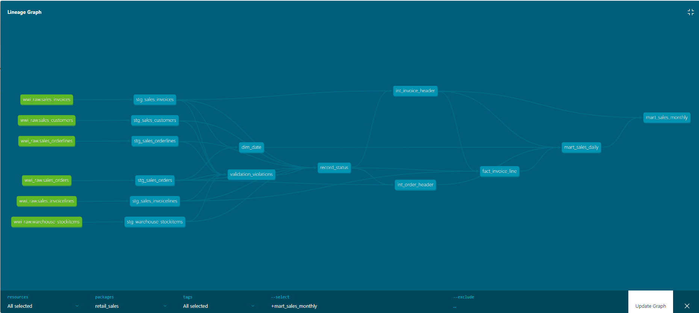
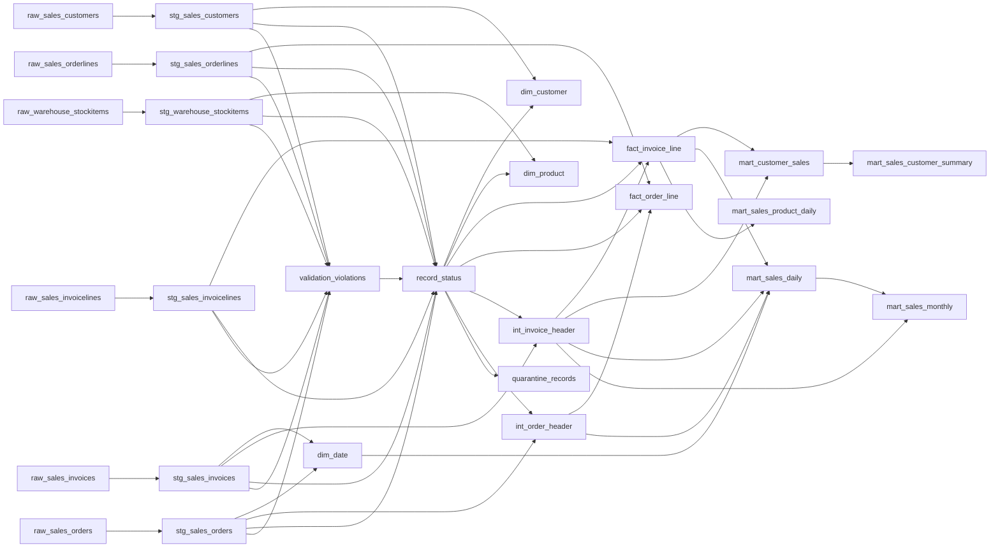

# dbt Sales Data Warehouse

## Overview

The dbt project transforms one explicit, reconciled Read Version from the Raw Layer into a Sales Data Warehouse. It owns SQL models, analytical measures and Data Quality contracts. [Ingestion](../ingestion/README.md) owns extraction and version state; [infrastructure](../infrastructure/README.md) owns privileged provisioning.

## Warehouse Architecture

The dependency direction is Raw sources → Staging Models → Data Quality and intermediate headers → Dimensions/Facts → Sales Marts. Headers retain independent order/invoice populations, while line-level Facts support additive sales and quantity measures. Data Quality status determines analytical eligibility without silently dropping invalid source records from population accounting.

## Model Layers

| Schema | Models | Responsibility |
|---|---|---|
| `dw_staging` | Six `stg_*` models | Typed source populations pinned to one Read Version |
| `dq` | `validation_violations`, `record_status`, `quarantine_records` | Rule failures, evaluated records and quarantine |
| `dw_intermediate` | `int_order_header`, `int_invoice_header` | Independent order/invoice headers |
| `dw_core` | Three Dimensions and two Facts | Observed attributes and transaction-line measures |
| `sales_marts` | Five Sales Marts | Daily, monthly, product and customer summaries |

The production graph contains 21 models and 69 data tests. The [demo project](demo/dbt_project.yml) is separate, with two models and seven data tests.

## Data Model and Grain

All grains are scoped to one Read Version. [Model descriptions](models/schema.yml) and the [staging schema](models/staging/schema.yml) document keys, purposes and Data Quality expectations.

| Model | Grain / key |
|---|---|
| `stg_sales_customers`, `stg_sales_orders`, `stg_sales_orderlines`, `stg_sales_invoices`, `stg_sales_invoicelines`, `stg_warehouse_stockitems` | Source row; record identity retains provenance without silent deduplication |
| `validation_violations` | Source record + rule + evaluation |
| `record_status`, `quarantine_records` | Evaluated record; quarantined evaluated record |
| `int_order_header`, `int_invoice_header` | OrderID / `source_order_id`; InvoiceID / `source_invoice_id` |
| `dim_date` | Calendar date / `date_key` |
| `dim_customer`, `dim_product` | Observed customer / `customer_key`; observed product / `product_key` |
| `fact_order_line` | OrderID + OrderLineID; unique `source_order_line_id` |
| `fact_invoice_line` | InvoiceLineID / `source_invoice_line_id` |
| `mart_sales_daily`, `mart_sales_monthly` | Calendar date; calendar month |
| `mart_sales_product_daily` | Invoice date + product |
| `mart_customer_sales` | Invoice date + customer + role |
| `mart_sales_customer_summary` | Customer + role |

Orders without invoices remain in Order Count. Invoice Count comes from invoice headers. Customer marts currently use BUYER attribution only; the role column does not imply two revenue populations. Buyer and Bill-to are alternative roles over the same sales, not additive totals. Facts and aggregate marts must not be joined to sum Sales, and overlapping distinct counts cannot be added across product/customer groups.

## Data Lineage



The dbt Docs view selects `+mart_sales_monthly`: six sources and Staging Models, Data Quality, two headers, `dim_date`, `fact_invoice_line` and the daily/monthly marts. It shows a dependency subset rather than all production models.

The graph below contains direct model/source dependencies, including refs generated by rule configuration. `raw_` prefixes identify source relations in FULL mode. INCREMENTAL uses version-resolving state functions for the same six populations. Relationship tests are not represented as model dependencies unless the model SQL also has that ref.

<!-- lineage:start -->

<!-- lineage:end -->

For offline documentation and dependency checks:

```powershell
.venv\Scripts\python.exe scripts/validate_portfolio.py
```

The validator creates a temporary invocation project under `.local/portfolio-validation/main`, runs `dbt parse` and `dbt docs generate --empty-catalog --no-compile`, then compares model descriptions and graph edges with the manifest. It uses a dummy profile without database connections. The empty catalog does not inspect live types, row counts or privileges.

## Business Measures

[measures.yml](config/measures.yml) specifies aggregation, date basis, eligibility, dimensional scope and NULL/zero behavior. [business_rules.yml](config/business_rules.yml) and [quality_rules.yml](config/quality_rules.yml) define the evaluation contract.

| ID | Measure | Population / definition | Date basis |
|---|---|---|---|
| S01 | Order Count | Eligible order headers | OrderDate |
| S02 | Invoice Count | Eligible invoice headers | InvoiceDate |
| S03 | Invoice Amount Including Tax | Sum ExtendedPrice on eligible invoice lines | InvoiceDate |
| S04 | Invoice Tax Amount | Sum TaxAmount on the same lines | InvoiceDate |
| S05 | Sales Before Tax | Sum (ExtendedPrice − TaxAmount) on the same lines | InvoiceDate |
| S06 | Average Invoice Value Before Tax | S05 / S02, ratio of totals | InvoiceDate |
| UNITS | Source Units Sold | Sum Quantity in source packaging units | InvoiceDate |
| C03 | Customer-role Sales | S05 attributed to Buyer or Bill-to | InvoiceDate |
| MOM / YOY | Sales growth | (Current − comparable prior) / prior, with monthly coverage guards | InvoiceDate |

Zero denominators return NULL. Money reconciliation tolerance is zero and ratio tolerance is `1e-12`. Warning records remain eligible where the contract allows; invalid/quarantined populations are accounted for separately. Source LineProfit does not define certified COGS, net profit or recognized revenue.

## Data Quality Tests

SQL tests in [tests](tests) cover Read Version pins, population accounting, keys, relationships, grains, source fidelity, eligibility, ratios, quarantine, KPI reconciliation and unresolved historical references. Rules distinguish warnings from invalid records rather than treating every exception as exclusion.

[acceptance.py](acceptance.py) and [bi_grants_acceptance.py](bi_grants_acceptance.py) provide scoped runtime checks. Inspect their options before use: fixture and rebuild modes can write to controlled test scopes. Offline regression runs through `python scripts/run_checks.py --portable` from the repository root.

## Materialization Strategy

| Layer | Materialization |
|---|---|
| FULL Staging Models | Views |
| INCREMENTAL Staging Models | Tables, to avoid repeated state-function scans |
| Intermediate headers | Views |
| Data Quality, core and marts | Tables |

[performance.yml](config/performance.yml) configures one thread and no optional indexes. The runner applies registered session memory settings and ANALYZE hooks. These settings are part of the runtime design; changing them requires repeatable measurements in an isolated environment.

## Version Selection

- `FULL` selects a successful, complete 11-object Full Load run UUID; staging filters source payload by `_run_id`.
- `INCREMENTAL` selects an eligible immutable version UUID; staging reads the six state functions for its parent/root chain.
- `_capture_id` carries the selected identity through analytical models. There is no fallback to latest, an older version or the publication pointer.

Read Version validation identifies a candidate; it does not provide Certified publication or advance source checkpoints.

## Running dbt

Install the pinned root [requirements](../requirements.txt): dbt-core 1.11.17 and dbt-postgres 1.11.0. Provision `retail_transform` and its schemas, then prepare its private password in ignored `.local/dbt/connection.json`. Create the BI reader identity before the first build as described in [initialization](../infrastructure/README.md#initialization).

[run_dbt.py](run_dbt.py) validates configuration and generates a private project/profile under `.local/dbt/invocations`. [profiles.yml.example](profiles.yml.example) describes the profile contract; it is not the active credentials file. The target is `127.0.0.1:55434/retail_raw` as non-admin `retail_transform`.

```powershell
# Run from the repository root. Replace UUID placeholders with verified values.
.venv\Scripts\python.exe dbt/run_dbt.py validate --capture-id <uuid>
.venv\Scripts\python.exe dbt/run_dbt.py debug --input-kind FULL --capture-id <full-run-uuid>
.venv\Scripts\python.exe dbt/run_dbt.py compile --input-kind FULL --capture-id <full-run-uuid>
# First build on a new, provisioned target; writes analytical objects.
.venv\Scripts\python.exe dbt/run_dbt.py build --input-kind FULL --capture-id <full-run-uuid>
# Subsequent explicitly authorized version-specific build and tests:
.venv\Scripts\python.exe dbt/run_dbt.py build --input-kind INCREMENTAL --capture-id <validated-version-uuid>
.venv\Scripts\python.exe dbt/run_dbt.py test --input-kind INCREMENTAL --capture-id <validated-version-uuid>
```

Run from the repository root and substitute verified canonical UUIDs. `validate` is configuration-only. `debug` and `compile` connect through runtime guards. `build` replaces analytical relations and runs tests; it requires explicit write scope. `test` runs database assertions without extraction. The wrapper has no `parse` command; use the offline validator for documentation. Keep generated profiles, artifacts and receipts outside Git.

## Security and Access

`retail_transform` reads approved Raw/metadata inputs and owns transformation schemas, without Raw/publication writes or administrative role flags. `retail_bi_reader` receives SELECT on five core models, two headers and five marts through model-level grants in [dbt_project.yml](dbt_project.yml). No folder/project grants expose staging, Raw, DQ or metadata.

Before BI refresh, verify all 12 serving objects share the intended Read Version and the reader retains SELECT access.

## Performance Considerations

Incremental state chains increase read cost even when no rows change. Table materialization at the staging boundary avoids evaluating those state functions repeatedly through the graph. One thread and bounded session memory favor predictable local execution; thread/index/materialization changes need isolated measurements rather than assumptions about a production workload.

## Operational Considerations

### Controlled replacement and recovery

[ddl_policy.py](ddl_policy.py) runs under advisory lock 941062 before `run`/`build`. It checks project paths, schemas/aliases, role ownership, protected permissions, stale artifacts and relation, row-type, function, trigger and RLS dependencies. Unknown consumers or orphan `__dbt_tmp`/`__dbt_backup` objects stop the build.

Replacement is limited to the 21 Sales models, their temporary/backup relations and two managed header views. The lifecycle can CREATE/RENAME, reapply grants, COMMIT and DROP a backup with CASCADE, removing a managed header view that is rebuilt later in the graph. Raw, ingestion metadata, checkpoints, publication state, SQL Server and unrelated schemas remain outside the replacement scope.

The graph is non-atomic. A failure can leave a partial serving graph. Before COMMIT, transaction rollback applies; after a committed change with lost acknowledgment or failed cleanup, inspect canonical/backup versions, ownership, dependencies and grants before recovery. Rebind managed consumers as needed and restrict cleanup to identified objects with DROP RESTRICT. Unexpected dependencies keep execution blocked; blanket CASCADE cleanup or expanding permissions is unsafe. The policy assumes reviewed code and no concurrent administrative DDL; it is not a general SQL firewall.

See [Airflow recovery](../airflow/README.md#retry-and-recovery) for rebuilding the dbt tail without unnecessary re-ingestion.

### Historical modeling and future scope

Customer/Product Dimensions use observed source labels, while Facts retain controlled unresolved historical keys/reasons. Complete transaction-time SCD Type 2 lookup and Certified coverage are future scope, with these design constraints:

- The Product Type 2 attribute whitelist is UnitPackageID, OuterPackageID and QuantityPerOuter. Only designated analytical attributes are Type 1; Tags/CustomFields stay excluded and transaction prices remain transactional.
- A persistent registry must distinguish natural keys, source occurrences and analytical versions, including supersession/recovery. ROW_NUMBER is not a durable surrogate identity; registry/rekey implementation is deferred.
- Date-only lookup requires full relevant-day coverage and exactly one analytical version identity, without beginning/end-of-day proxies or merging disjoint matching episodes.
- Hybrid history must reconcile source history with forward observations, preserving system-time, observation-time and analytical validity. The final analytical-validity algorithm/datatype must retain the required 100-nanosecond precision.
- Unresolved Facts remain visible without current/earliest fallback or silent removal. Multi-match integrity must block affected publication. Type 1 corrections require impact/reconciliation/recovery handling; correcting AccountOpenedDate does not automatically create an SCD Type 2 episode.
