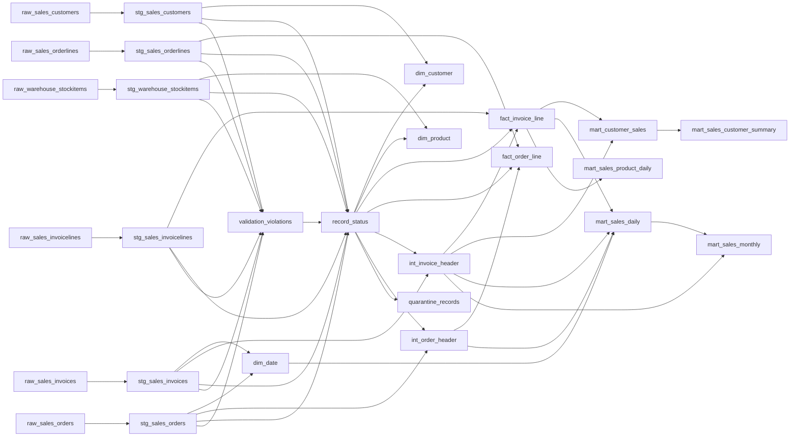

# dbt Sales Warehouse

This module transforms one explicit, reconciled Raw version into staging, data quality records, a core warehouse and five Sales Marts. It owns SQL models and executable business contracts. [Ingestion](../ingestion/README.md) owns extraction; [infrastructure](../infrastructure/README.md) owns privileged provisioning.

## Setup and Version Selection

Install the pinned root [requirements](../requirements.txt) in the Windows `.venv`: dbt-core 1.11.17 and dbt-postgres 1.11.0. Provision `retail_transform` and its schemas first, set a private password and prepare ignored `.local/dbt/connection.json` with a `password` field. See the infrastructure README for the BI reader pre-build identity requirement.

[run_dbt.py](run_dbt.py) validates YAML and creates an invocation-specific project/profile under `.local/dbt/invocations`. [profiles.yml.example](profiles.yml.example) describes the profile; it is not the active credentials file. Target: `127.0.0.1:55434/retail_raw`, non-admin `retail_transform`, one thread. Do not use `postgres` for transformations.

- `FULL`: select a successful, complete 11-object Full Load **run UUID**; source rows are pinned by `_run_id`.
- `INCREMENTAL`: select an eligible immutable version UUID; staging reads the six typed state functions for its parent/root chain.
- No fallback to latest, a previous version or the publication pointer. `_capture_id` carries the selected read identity through models.

```powershell
# Run from the repository root. Replace UUID placeholders with verified values.
.venv\Scripts\python.exe dbt/run_dbt.py validate --capture-id <uuid>
.venv\Scripts\python.exe dbt/run_dbt.py debug --input-kind FULL --capture-id <full-run-uuid>
.venv\Scripts\python.exe dbt/run_dbt.py compile --input-kind FULL --capture-id <full-run-uuid>
# First build on a new, provisioned target; writes analytical objects.
.venv\Scripts\python.exe dbt/run_dbt.py build --input-kind FULL --capture-id <full-run-uuid>
# Subsequent explicitly authorized version-specific build and tests:
.venv\Scripts\python.exe dbt/run_dbt.py build --input-kind INCREMENTAL --capture-id <validated-version-uuid>
.venv\Scripts\python.exe dbt/run_dbt.py test --input-kind INCREMENTAL --capture-id <validated-version-uuid>
```

`validate` is configuration-only. `debug`/`compile` connect through runtime guards; `build` replaces analytical relations and runs data tests. `test` can execute assertion/fidelity queries but is not an ingestion operation. The wrapper does not expose a `parse` command; ordinary dbt parse can inspect its generated private project without building models. Keep outputs and receipts out of Git.

## Model Layers and Grains

All grains below are within a single read version. There are **21 models**.

| Schema | Models | Grain / responsibility |
|---|---|---|
| `dw_staging` | `stg_sales_customers`, `stg_sales_orders`, `stg_sales_orderlines`, `stg_sales_invoices`, `stg_sales_invoicelines`, `stg_warehouse_stockitems` | Six typed source populations, no silent deduplication |
| `dq` | `validation_violations`, `record_status`, `quarantine_records` | Rule failures; evaluated source record; quarantined record |
| `dw_intermediate` | `int_order_header`, `int_invoice_header` | OrderID; InvoiceID, independently retained header populations |
| `dw_core` | `dim_date`, `dim_customer`, `dim_product` | Calendar date; observed customer key; observed product key |
| `dw_core` | `fact_order_line`, `fact_invoice_line` | OrderID + OrderLineID; InvoiceLineID |
| `sales_marts` | `mart_sales_daily`, `mart_sales_monthly` | Calendar date; calendar month |
| `sales_marts` | `mart_sales_product_daily` | Invoice date + product |
| `sales_marts` | `mart_customer_sales`, `mart_sales_customer_summary` | Invoice date + customer + role; customer + role |

FULL staging uses views; INCREMENTAL staging is materialized according to [performance.yml](config/performance.yml) to avoid repeated state-function scans. The two headers are views. Core, quality and marts use tables. Customer marts currently contain BUYER attribution only; their role column does not imply two independent revenue populations.

Order counts come from Orders and preserve orders without invoices. Invoice counts come from Invoices. Customer/Product observed keys support current labels; historical unresolved references remain distinguishable. Never join the two facts, or facts and aggregate marts, to sum Sales. Distinct counts across overlapping product/customer groups cannot simply be added.

## Business Measures

[measures.yml](config/measures.yml) defines aggregation, date basis, eligibility, NULL/zero policy and dimensional scope. [business_rules.yml](config/business_rules.yml) and [quality_rules.yml](config/quality_rules.yml) control evaluation; do not change them to bypass a failed gate.

| ID | Measure | Definition / population | Date basis |
|---|---|---|---|
| S01 | Order Count | Eligible order headers | OrderDate |
| S02 | Invoice Count | Eligible invoice headers | InvoiceDate |
| S03 | Invoice Amount Including Tax | Sum ExtendedPrice, eligible invoice lines | InvoiceDate |
| S04 | Invoice Tax Amount | Sum TaxAmount, same eligible lines | InvoiceDate |
| S05 | Invoiced Sales Before Tax | Sum (ExtendedPrice − TaxAmount), same eligible lines | InvoiceDate |
| S06 | Average Invoice Value Before Tax | S05 / S02, ratio of totals | InvoiceDate |
| UNITS | Source Units Sold | Sum Quantity; source packaging units | InvoiceDate |
| C03 | Sales by Selected Customer Role | S05 attributed separately to Buyer or Bill-to | InvoiceDate |
| MOM / YOY | Captured Sales Growth | (Current − comparable prior) / prior; monthly coverage guards | InvoiceDate |

Zero denominator returns NULL. Money reconciliation tolerance is zero; ratio tolerance is `1e-12`. Warning records remain eligible where allowed; invalid/quarantined populations are accounted for separately. Buyer and Bill-to represent the same Sales and must not be added. Source LineProfit is not a certified COGS/profit/revenue-recognition definition.

## Data Quality and Validation

SQL tests in [tests](tests) cover pins, populations, keys, grains, source fidelity, eligibility, ratios, quarantine, reconciliation and historical unresolved handling. An accepted local build passed **21 models and 69 data tests**; this historical result is not proof for a future build/version.

[acceptance.py](acceptance.py) and [bi_grants_acceptance.py](bi_grants_acceptance.py) are controlled validation utilities; inspect their help/scope before runtime use. Fixtures and rebuild modes are not routine read-only checks. Run the root offline suite with `.venv\Scripts\python.exe scripts/run_checks.py`.

## Controlled DDL, Grants and Recovery

Before `run`/`build`, [ddl_policy.py](ddl_policy.py) checks the reviewed project, target/role, existing ownership, protected Raw/metadata permissions, stale artifacts and dependent relations/functions/triggers/policies while the runner holds advisory lock 941062.

Approved replacement is limited to the 21 Sales transformation models and their dbt intermediate/backup relations. Table replacement may rename old/new relations, reapply grants, commit, then DROP the backup with CASCADE. The two known header views may be removed as dependencies and rebuilt later in the graph. Unapproved consumers or stale `__dbt_tmp`/`__dbt_backup` objects stop the build. Raw, ingestion metadata, checkpoints, publication state, source objects and unrelated schemas are protected.

This is not an atomic graph publication or a generic SQL firewall. Use reviewed models/macros and exclude concurrent administrative DDL. A failed build may leave partial serving state. Before COMMIT, rollback behavior was verified in isolated tests; after a successful COMMIT with lost acknowledgment/cleanup failure, inspect canonical/backup data, dependencies and grants. Do not blindly rerun or re-extract. See [Airflow recovery](../airflow/README.md).

SELECT grants for `retail_bi_reader` are configured on exactly five core models, two headers and five marts in [dbt_project.yml](dbt_project.yml). No project/folder grants expose Raw, staging, DQ or metadata. After rebuilding, verify all 12 objects share the intended version and reader access before a separate Power BI refresh.

## Historical Modeling Boundaries

Approved design direction is retained here; these policies do not claim a completed historical implementation:

| Policy | Preserved decision / implementation boundary |
|---|---|
| Product attributes | Type 2 whitelist: UnitPackageID, OuterPackageID, QuantityPerOuter. Only approved analytical attributes are Type 1; Tags/CustomFields remain excluded. Transaction prices stay transactional. |
| Surrogate identity | A persistent registry should manage opaque analytical SKs, supersession and recovery. Natural key, source occurrence and analytical version differ; ROW_NUMBER is not a durable SK. Registry/rekey implementation remains deferred. |
| Date-only lookup | Resolve only with full relevant-day coverage and exactly one analytical version identity. No beginning/end-of-day proxy; do not merge disjoint episodes because values match. |
| Hybrid history | Reconcile verified source history with forward observations; preserve lineage and distinguish system-time, observation-time and analytical validity. Do not invent intermediate changes or lose forward evidence on reload. |
| Exact precision | Raw source identity uses verified 100-ns F2 text. This does not select the final analytical-validity datatype/algorithm or permit microsecond-only historical predicates. |
| Unresolved and Certified gates | Retain source facts with controlled unresolved keys/reasons. No current/earliest fallback, silent fact removal or successful-match claim; multi-match integrity blocks affected publication. Certified coverage remains unimplemented. |

Type 1 corrections need explicit impact, reconciliation and recovery handling; an AccountOpenedDate correction does not automatically create an SCD2 episode. Physical cutover, complete historical lookup and Certified mart coverage must be resolved separately from the implemented observed-current MVP.

## Verified Model Lineage


Ảnh dbt Docs thật do chủ dự án cung cấp dùng selector `+mart_sales_monthly`, hiển thị upstream dependencies của Monthly Sales Mart: sáu Raw sources/staging models, DQ, hai headers, `dim_date`, `fact_invoice_line`, `mart_sales_daily` và `mart_sales_monthly`. Ảnh chỉ thể hiện phần lineage này, không hiển thị đủ 21 production models hoặc trạng thái data test execution. Ảnh được giữ nguyên; [provenance và SHA256](../docs/assets/provenance.json).

Các mũi tên dưới đây là dependency trực tiếp từ manifest của **21 production models** sau offline parse, bao gồm các refs sinh bởi rule configuration. Prefix `raw_` biểu diễn source relation; parse dùng FULL nên source đi vào staging qua `source()`. INCREMENTAL dùng state functions cho cùng sáu population. Các relationship tests giữa fact/dimension không được vẽ thành model refs nếu SQL không có ref đó.

<!-- lineage:start -->

<!-- lineage:end -->

Purpose, grain, business keys, metrics và DQ được mô tả ngay trong [schema.yml](models/schema.yml) và [staging schema](models/staging/schema.yml). Mọi grain thuộc một read version. Staging FULL=view, INCREMENTAL=table; headers=view; core/DQ/marts=table. Không thay threads=1, indexes=false hoặc materializations trong lượt này.

## Portfolio Validation

```powershell
.venv\Scripts\python.exe scripts/validate_portfolio.py
```

Lệnh tạo project/profile giả tại `.local/portfolio-validation/main`, chạy `dbt parse` rồi `dbt docs generate --empty-catalog --no-compile`, kiểm tra descriptions và so sánh toàn bộ cạnh Mermaid với manifest. Profile dùng localhost port 1 và database giả; không kết nối live, không build hoặc gọi run-start runtime guards. Catalog rỗng nên không xác nhận kiểu/row count/privileges của database. Live compile không chạy trong lượt này.

Demo [demo/dbt_project.yml](demo/dbt_project.yml) là project riêng, hai model và bảy data tests; không nằm trong 21 production models hay 69 accepted tests. Lượt này demo build PASS trên database cô lập; production build không chạy.

Chưa có ảnh chụp dbt terminal phù hợp: khi chủ dự án chạy demo, có thể chụp summary từ log đã kiểm tra không chứa secrets (`2 table models, 7 data tests`). Nếu muốn bằng chứng production 21/69, dùng accepted logs hoặc lần chạy được cấp scope riêng; không dựng ảnh từ văn bản để giả runtime.
