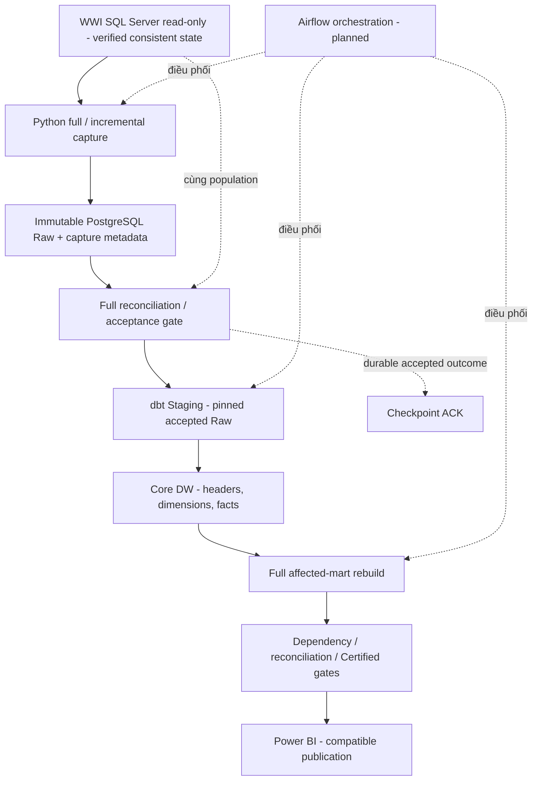

# Data Flow

**Planned — Not implemented yet.** Không có production warehouse/ETL/DAG được triển khai. [DW-04 Assessment](../data-models/wwi-dw-04-assessment.md) và [Handoff](../data-models/wwi-implementation-readiness-handoff.md) giữ traceability/dependency/acceptance; không runtime evidence mới.

1. SQL Server WideWorldImporters chỉ đọc cung cấp9 current source contracts và2 physical archives tương ứng. A02 yêu cầu verified consistent population; không sửa WWI gốc/enable CDC/CT/isolation.
2. Python full/incremental ingestion đọc explicit projection, giữ source types/NULL/exact values; tách source context, capture, run, attempt, logical batch, publication identity. Timestamp candidates không thay full reconciliation.
3. PostgreSQL immutable Raw giữ physical occurrence multiset, kể cả temporal zero-duration và valid duplicate source values. Idempotent delivery retry không là DISTINCT/deduplicate source history. Incomplete/invalid/fidelity-unknown capture được giữ evidence và hold normal publication; không drop/quarantine rồi gọi phần còn lại là complete. Reconciliation/count/keys/values/occurrences đạt trước accepted Raw publication, durable outcome trước checkpoint ACK.
4. dbt staging biến đổi có lineage từ exact accepted Raw pins; validation/quarantine phải giữ source evidence, population accounting và gates phù hợp, không im lặng mất dòng. Core DW tạo2 headers/4 dims/4 facts theo grain đã duyệt. Sales ban đầu đã cần minimum Customer/Product SCD2 registry/lookup/R-U-I; không fallback current/earliest. Customer Analytics/Inventory mở rộng sau Sales.
5. Basic DQ đi cùng ingestion/Core; reconcile cùng state/population/grain/date, giữ signed movements, money precision và Buyer/Bill-to riêng. StockItemHoldings current/Product phải cùng published state; observed_at khác published_at, không daily balance. Runtime tests trước relevant acceptance/publication, không chờ Phase6.
6. Marts dùng full affected-mart rebuild baseline, old/new groups+unchanged members; ratios/distinct counts tính lại. D1 frozen Type1 selected-set, D2 complete dependency graph/exact pins và cross-subject joint manifest; B5 Certified gates chưa có numerical values. Power BI tiêu thụ đúng role/filter/compatible publication, không multi-fact fan-out.
7. Airflow điều phối Sales trước, retry/recovery/ACK và D3 lifecycle theo Owner/operator authority; không business logic trong DAG hoặc uncertified rollback fallback. Phase6 monitoring nâng cao; sau Sales mới Customer rồi Inventory. Purchasing/Finance/BigQuery chỉ theo extension task riêng.

Nguồn restore đứng yên không chứng minh incremental INSERT/UPDATE; test changed-state chỉ trên môi trường độc lập được Owner duyệt. Temporal system-time không mặc định đủ lịch sử business-effective. No-writes interval/consistent-copy, physical/runtime mechanisms và thresholds vẫn là gates, không được giả định bằng sơ đồ.
