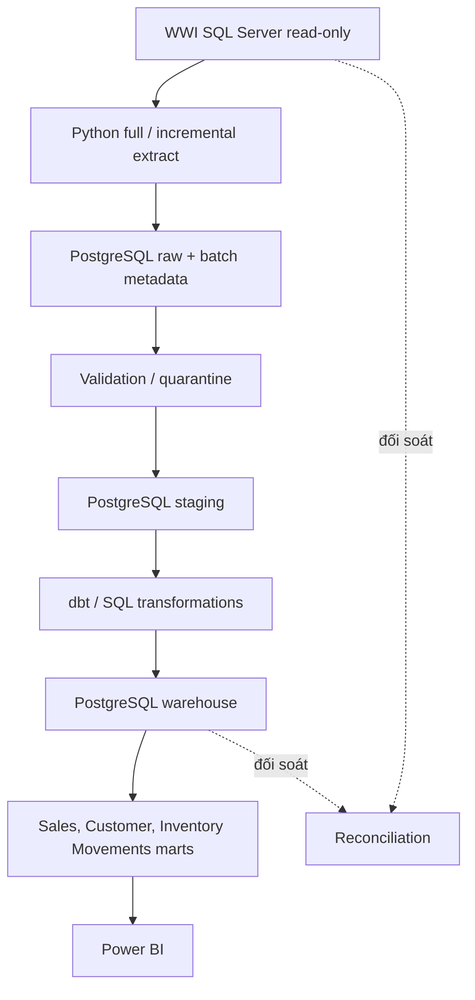

# Data Flow

**Planned — Not implemented yet.** Không có bảng warehouse, ETL job hoặc DAG của dự án đã triển khai.

1. SQL Server `WideWorldImporters` cung cấp các bảng OLTP theo source contract WWI-02. Quyền sử dụng nguồn là **read-only**.
2. Python ingestion dự kiến full extract, sau đó incremental theo chiến lược WWI-04 được duyệt; gắn source table, extraction time, batch ID, checkpoint và retry metadata.
3. PostgreSQL raw giữ dữ liệu/batch lineage; staging chuẩn hóa, deduplicate, validation và quarantine record sai kèm lý do.
4. dbt/SQL tạo facts/dimensions đúng grain trên PostgreSQL warehouse. Sales/Invoicing là lát cắt đầu tiên; customer SCD2 và inventory movements theo sau khi có quyết định phù hợp.
5. Data quality cơ bản chạy từ ingestion/warehouse; reconciliation so count/amount/quantity ở cùng grain, kỳ, population. Phase 6 bổ sung quality gates và monitoring tập trung.
6. Airflow điều phối Sales pipeline độc lập trước; Customer/Inventory được bổ sung sau. Marts phục vụ Power BI.
7. BigQuery, Purchasing và Finance chỉ là extensions theo task riêng.

Bản restore nguồn đứng yên không tự chứng minh incremental INSERT/UPDATE. WWI-04 thiết kế môi trường thử nghiệm độc lập; chưa tạo hoặc thay đổi dữ liệu nguồn. Temporal history không được coi là đủ cho mọi giao dịch.