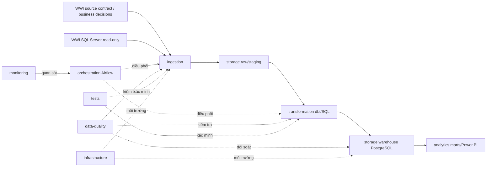

# Module Dependencies

**Planned — Not implemented yet.** Mũi tên là phụ thuộc thiết kế, không phải import code đã tồn tại.

Sales pipeline từ extract đến mart, Airflow, data quality và monitoring được hoàn thiện trước khi mở rộng Customer rồi Inventory Movements. Quality checks cơ bản là dependency của ingestion/warehouse, không chờ Phase 6. Các module không phụ thuộc ngược từ nguồn vào analytics. `docs` ghi source contract và quyết định; `.github` chứa CI sau khi Git/code được thiết lập; `scripts` hỗ trợ task cụ thể.