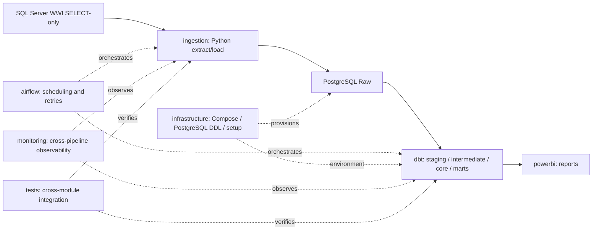

# Module Dependencies — ownership hiện hành

REPO-STRUCTURE-02 chỉ đổi đường dẫn/trách nhiệm thư mục, không thay hệ thống nguồn/đích, grain, KPI hoặc approved architecture.

- ingestion/common giữ runtime config/contract/codecs; extractors và loaders không phụ thuộc dbt/Power BI.
- infrastructure/scripts/check_raw_connection.py cung cấp Raw config/probe dùng chung với ingestion; không import ingestion ngược lại. Provisioning chỉ gọi riêng khi được phép, không import-time mutation.
- ingestion/tests sở hữu unit/offline tests của extraction/load. infrastructure/tests sở hữu provisioning/config/resource checks. tests/integration giữ đối soát source–Raw và B9 vì chúng xuyên module.
- dbt sở hữu SQL marts, model tests và project config; infrastructure sở hữu schema provisioning. Bản nháp dbt được bảo toàn, chưa runtime acceptance.
- powerbi sở hữu reports/assets, không chứa KPI definitions chung hoặc marts SQL.
- docs/requirements/kpi-definitions giữ KPI/business definitions; docs/data-models và ADR giữ thiết kế đã duyệt; history ở docs/archive.
- scripts chỉ project-wide utilities. DQ checks nằm gần stage thực thi; [DQ ownership](data-quality-ownership.md), không có module placeholder song song.

Full Load đã runtime accepted ngày 2026-11-19, chưa publication. dbt/Airflow/Power BI chưa runtime verified. [Current tree/migration/runtime blocker](../../README.md), [tracker](../../TASKS.md). Không thay milestone sequencing: Sales-first, Airflow sau stable executable pipelines.
