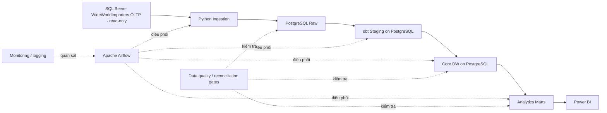

# System Overview

## Status

**Planned — Not implemented yet.** SQL Server WWI đã được khảo sát trong các assessment trước; sơ đồ là kiến trúc được duyệt, không phải pipeline đã chạy. [DW-04 Assessment](../data-models/wwi-dw-04-assessment.md) đối chiếu thiết kế liên giai đoạn; [Gate Register](../data-models/wwi-implementation-gate-register.md) tách physical/runtime prerequisites. WWI-04/Phase1 In Progress; Phase2–9 Not Started.

MVP Sales/Invoicing end-to-end trước Customer Analytics rồi Inventory Movements. Purchasing, Finance và BigQuery là extensions có kiểm soát. Docker Compose/môi trường nguồn thử nghiệm độc lập cần task/phê duyệt triển khai riêng; chưa tạo trong DW-04.

## Ranh giới trách nhiệm

Python ingestion đọc source và nạp Raw cùng metadata/capture/retry/checkpoint theo accepted publication protocol; không tính KPI. Storage quản lý physical Raw/staging/Core/registry/manifests; dbt sở hữu biến đổi staging→Core→marts theo business rules. Analytics tiêu thụ marts qua compatible publication/semantic contracts. Airflow điều phối, không chứa business logic. Basic DQ/reconciliation cùng ingestion/dbt trước publish; Phase6 monitoring/quality nâng cao, không trì hoãn correctness tests.

Raw bảo toàn full projection và physical temporal occurrences/NULL/precision; retry delivery idempotency không được gộp valid source duplicates. Authoritative datetime2(7) theo scoped B9 F2→str/None→bound psycopg→TEXT/C; không mất100ns hoặc suy business-effective time. Current-state convergence không complete CDC. Checkpoint sau durable accepted Raw publication; Certified analytics còn dependency/registry/reconciliation/B5/consumer gates.

Kimball [logical model](../data-models/wwi-logical-dw-design.md) giữ2 headers,4 conformed dimensions,4 facts,6 marts. Order/invoice counts từ header riêng; buyer/bill-to tách; không JOIN fact khác grain để cộng measures. Minimum Customer/Product registry/lookup cần cho Sales Core; expanded Customer Analytics/Inventory làm sau Sales. Current inventory cùng Product/current published state, observed_at khác published_at; không daily historical balance.

## Approved policies và implementation gates

BRD-01–12, DW-01/L01–05, DW-02/B1–B8, DW-03A/A01–A06 theo đúng conditional/direction scope, INC-01–06, CP-01–06, D1/D2 Logical và D3 Governance đã ghi nhận; D4 confirmed. B9 chỉ Approved Physical Raw Temporal Representation, không entire Raw schema. [SCD Final Spec](../data-models/wwi-final-scd2-design-specification.md) và [DW-03C Register](../data-models/wwi-dw-03c-decision-register.md) giữ authority chi tiết.

[Open Decisions](../../PROJECT_SCOPE.md#open-decisions) hiện là concrete consistency/least-privilege profiles, physical schema/adapters/algorithms/intervals/reference contracts, numeric thresholds và per-action runtime approvals. Không mở lại approved business/SCD/incremental/propagation policies. Source WWI vẫn read-only; source consistency cần actual proof theo A02, không suy từ read-only client/PoC hoặc old timestamps.
