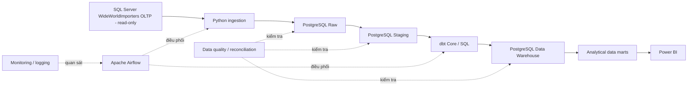

# System Overview

## Status

**Planned — Not implemented yet.** WWI SQL Server local đã được kiểm tra trong đợt assessment; sơ đồ dưới đây là kiến trúc dự án, không mô tả pipeline đã chạy. KPI nghiệp vụ đã duyệt ở Phase 1.5; DW-01 đã nghiệm thu thiết kế logic theo Kimball Star Schema với Conformed Dimensions, bốn facts chi tiết và marts riêng cho Power BI. Physical schema chưa phê duyệt.

MVP triển khai Sales/Invoicing end-to-end trước, sau đó Customer Analytics và Inventory Movements. Purchasing, Finance và BigQuery là extensions. Docker Compose dự kiến quản lý môi trường local khi có task triển khai.

## Ranh giới trách nhiệm

Ingestion đọc nguồn, gắn batch metadata/checkpoint và nạp raw/staging; không tính KPI. Storage quản lý lớp dữ liệu; dbt biến đổi theo business rules đã duyệt; analytics đọc marts. Airflow điều phối nhưng không chứa business logic. Kiểm tra chất lượng cơ bản đi cùng ingestion/dbt, Phase 6 bổ sung quality gates tập trung và failure scenarios nâng cao.

Không JOIN trực tiếp Orders, OrderLines, Invoices, InvoiceLines, CustomerTransactions và StockItemTransactions ở grain khác nhau để cộng measures. BRD-01–BRD-12 đã duyệt; chi tiết [logical DW design](../data-models/wwi-logical-dw-design.md) đã nghiệm thu ở mức logic. L01–L05 đã duyệt định hướng initial full, periodic incremental/full reconciliation, change detection theo nhóm nguồn, test DML trên môi trường độc lập, idempotency/SCD2/restate và Sales-first. SCD2 policy, thuật toán incremental và physical schema vẫn là [Open Decisions](../../PROJECT_SCOPE.md#open-decisions). WWI gốc chỉ đọc; chưa tạo test environment.
