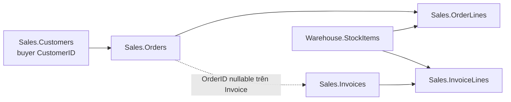
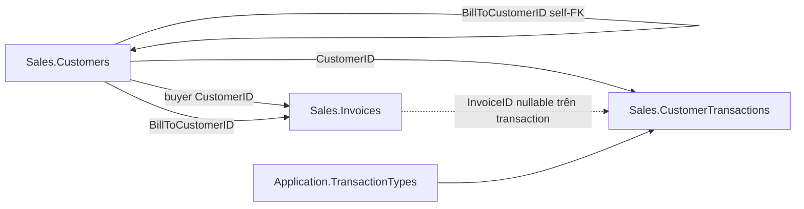
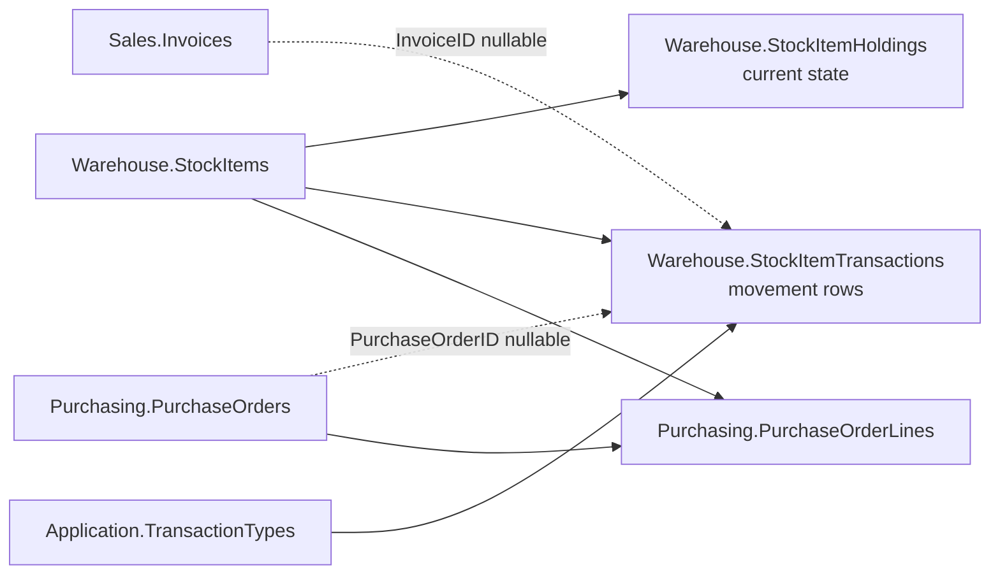

# WWI Business Data Flow — Phase 1.3

**Trạng thái:** mô tả quan hệ dữ liệu nguồn đã kiểm tra; Project Owner đã chấp thuận ở mức tài liệu/khảo sát ngày 2026-11-09. Đây không phải thiết kế pipeline, KPI hay warehouse. Xem [Source ERD](wwi-source-erd.md), [relationship contract](wwi-source-relationships.md) và [SQL evidence](wwi-relationship-validation-sql.md).

## Sales/Invoicing

**Verified:** mỗi order line có một order và một stock item; mỗi invoice line có một invoice và một stock item. `Invoices.OrderID` nullable theo schema, nhưng 0 NULL trong snapshot; 3.085 orders chưa có invoice. Các line tables không có FK trực tiếp với nhau.

## Customer và giao dịch tài chính nguồn

**Verified:** invoice giữ buyer và bill-to customer riêng; 44.245 invoice có hai ID khác nhau. Type `Customer Invoice` có InvoiceID, CustomerID của transaction khớp bill-to trên invoice ở snapshot. Type `Customer Payment Received` có InvoiceID NULL. **Unverified:** invoice mà một payment thanh toán, số tiền phân bổ hay revenue recognition; không diễn giải bằng phép join theo CustomerID.

## Inventory và Purchasing dependency

**Verified:** 228.265 Stock Issue rows nối invoice; 8.358 Stock Receipt rows nối purchase order; 44 stocktake adjustments không có cả hai. Dòng đứt thể hiện FK nullable, không phải quan hệ không có FK. Đối soát issue với invoice lines và receipt với PO lines chỉ ở nhóm `(document ID, StockItemID)`. Holdings là trạng thái hiện tại; không thể dựng daily balance khi opening balance và quy tắc stocktake chưa được duyệt.

## Ranh giới suy luận

Source timestamps, temporal versions và relationship count không xác nhận SCD2, incremental policy, KPI hoặc fact grain. Tài liệu này chỉ mô tả luồng tham chiếu nguồn; đề xuất business rules thuộc task khác và cần Project Owner phê duyệt.
