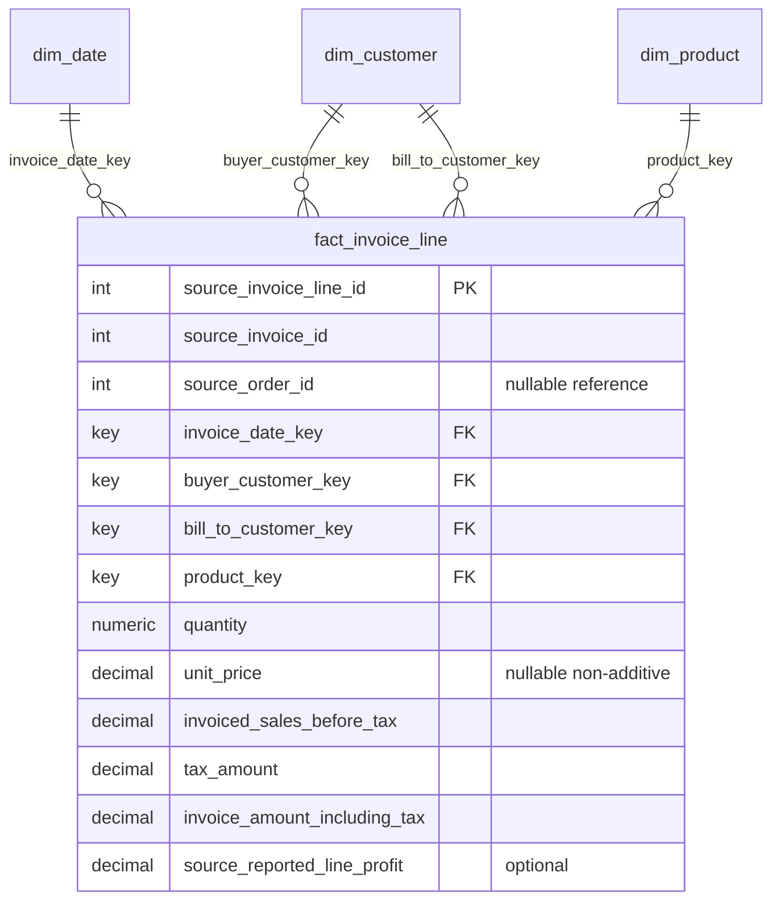
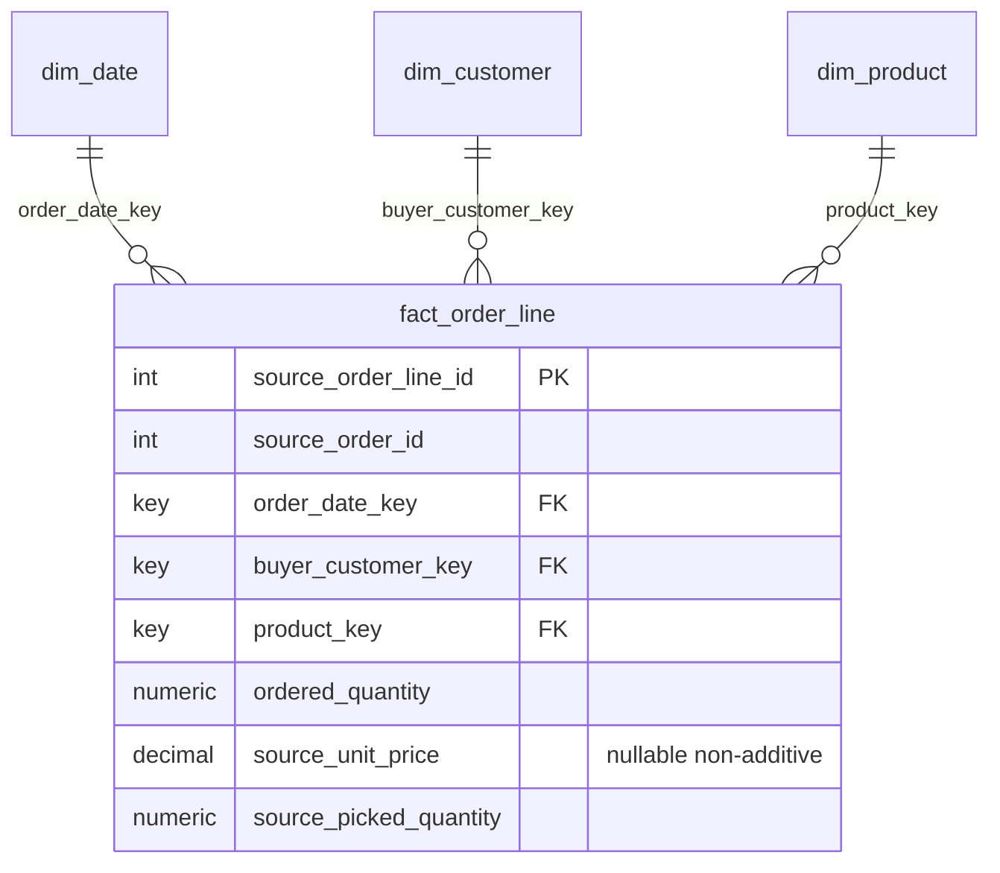
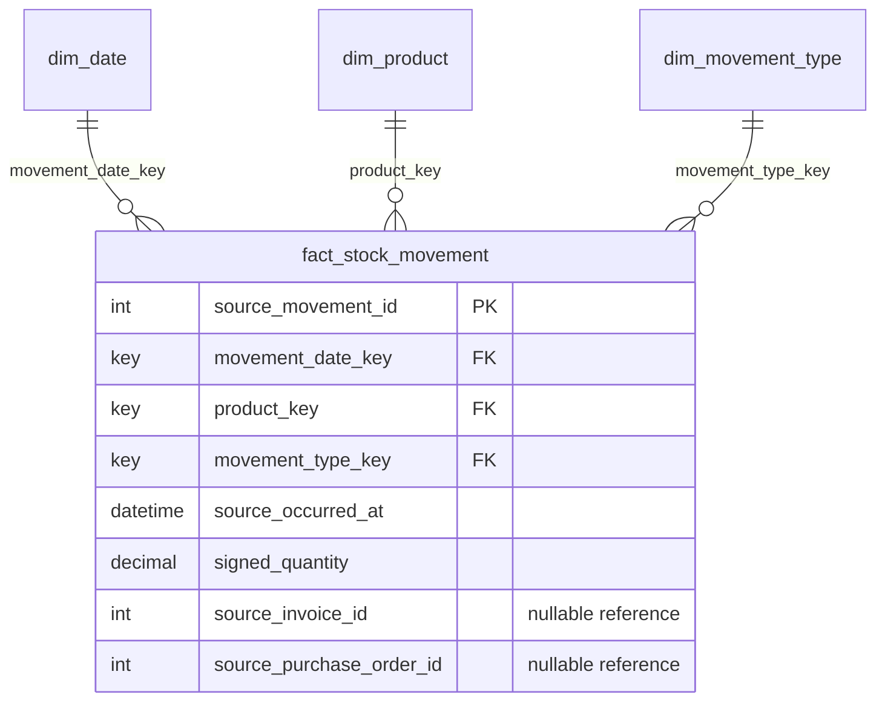
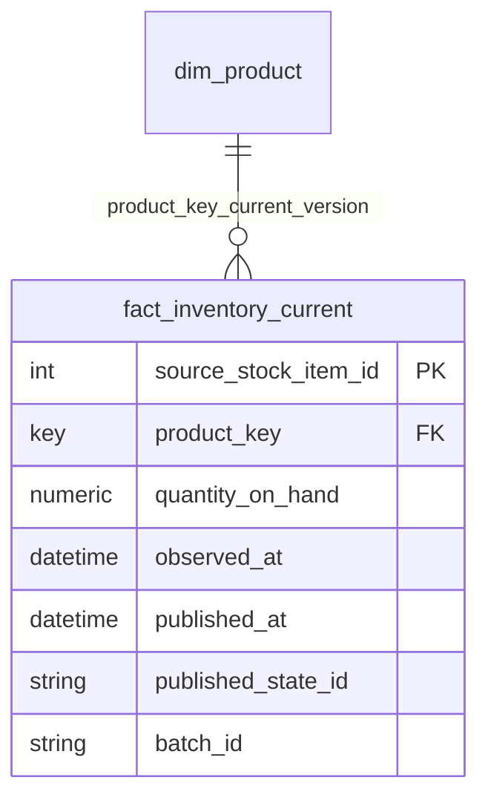
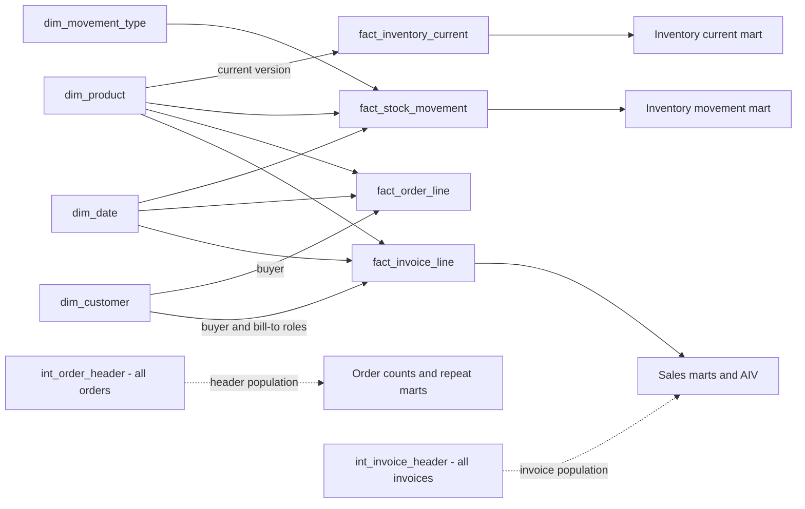

# WWI Logical Star Schemas — DW-01

**DW-01 logical diagrams accepted.** Logical relationships đích, không phải FK đã triển khai. Đối chiếu [Fact & Dimension Dictionary](wwi-fact-dimension-dictionary.md) và [Bus Matrix](wwi-logical-dw-design.md). Mỗi FK fact phải resolve đúng một version sau policy unknown/history được duyệt; ERD không khẳng định nguồn có đủ lịch sử. Source IDs khác tên là logical aliases, không phải cột nguồn mới.

## 1. Invoice Line Star

Hai cạnh dim_customer là hai alias role của cùng dimension. InvoiceID không là FK nối fact_order_line hoặc fact_stock_movement. Count toàn invoice lấy intermediate header, không SUM trên line.

## 2. Order Line Star

int_order_header bao phủ mọi order, không phải fact thứ năm. Order không line không có record trong fact_order_line; vẫn được S01/C01/C02 tính tại header.

## 3. Stock Movement Star

Optional document references không tạo đường join fact-to-fact. Đối soát riêng các tập aggregate document-product.

## 4. Current Inventory Star

Grain một StockItemID trong **một current published state**, không `(StockItemID, date)`. Mỗi current fact có đúng một dimension key theo lookup policy. Một real resolved product version chỉ gắn tối đa một current item; cardinality 0..N ở diagram cho phép candidate unknown chung khi nhiều source NK chưa resolve. Dimension có nhiều versions nhưng holdings chọn current version duy nhất; các version cũ không có current holding. Không thêm dim_date vào current fact.

## 5. Consolidated Kimball Bus

Các cạnh dimension→fact thể hiện resolved/published SK, không phải JOIN natural key với toàn bộ version history. Lookup 0 match và fallback chờ DW-02; >1 match là ambiguity. Current inventory product_key gắn với published_state_id đã kiểm, observed_at và published_at là hai thời điểm riêng.

Bus arrows là dependency dùng chung, không chỉ định physical JOIN. Product/customer SK version keys không được dùng để distinct entity qua thời gian. Không có cạnh nối trực tiếp hai facts; drill-across chỉ sau aggregate về common grain và semantics đã xác định.
