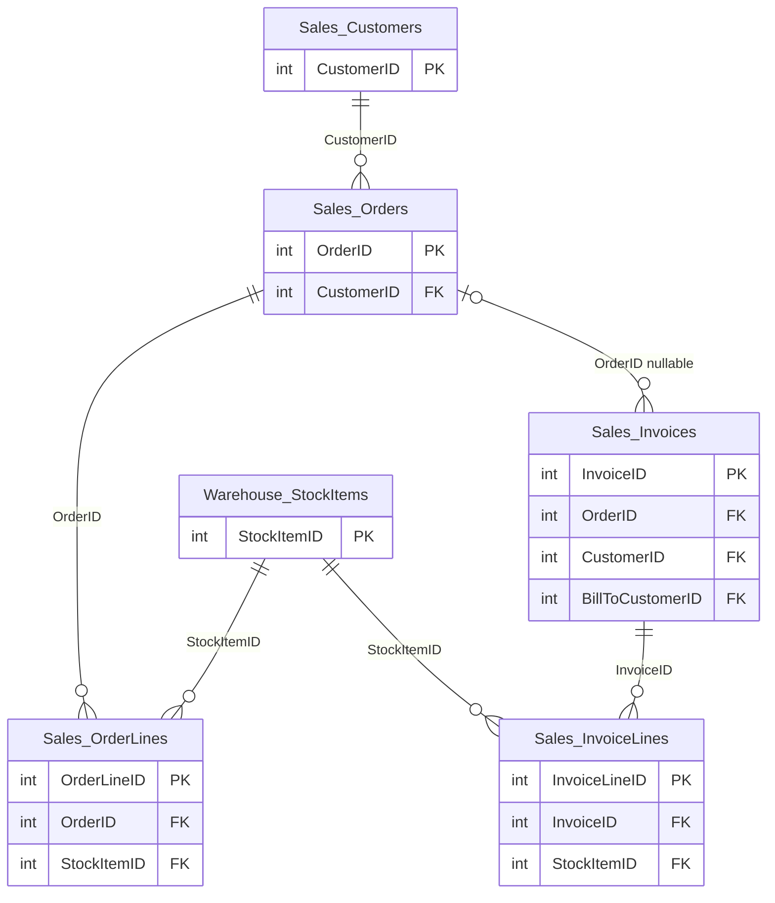
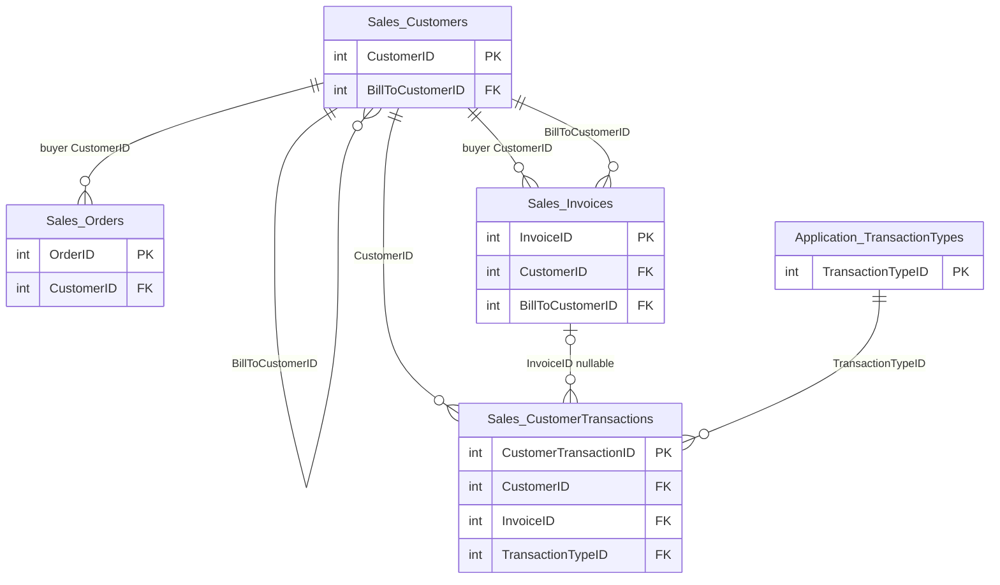
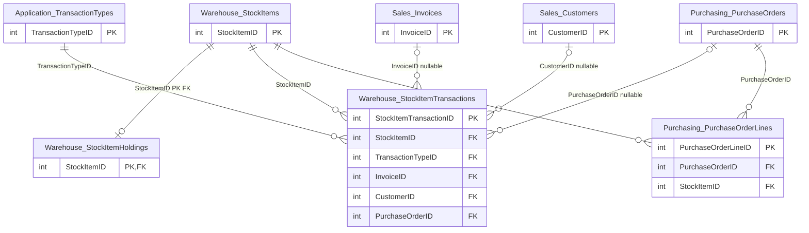
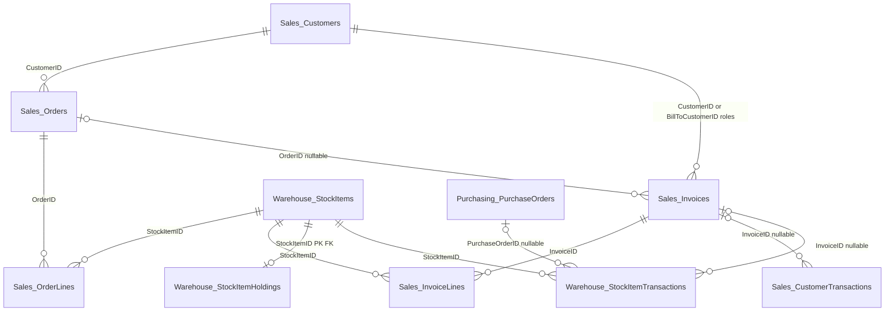

# WWI Source ERD — Phase 1.3

**Trạng thái:** mô hình quan hệ nguồn dựa trên FK enabled/trusted và nullable metadata, đối chiếu snapshot ngày 2026-11-07. Chờ Project Owner review. `||` = đúng một parent cho child; `o|` = parent tùy chọn đối với child; `o{` = 0..N child theo schema; `o|` ở phía child = 0..1 child khi child FK cũng là PK. Số lượng thực tế ở [relationship contract](wwi-source-relationships.md). Diagram chỉ vẽ FK thực; quan hệ quan sát không có FK được ghi bên dưới.

## 1. Sales & Invoicing

## 2. Customer & Financial Transactions

Hai cạnh từ `Sales_Customers` tới `Sales_Invoices` thể hiện **hai role khác nhau**, cùng tham chiếu `Customers.CustomerID`. Cạnh tự tham chiếu là `Customers.BillToCustomerID`.

## 3. Inventory & Purchasing Dependencies

`StockItemHoldings.StockItemID` đồng thời là PK và FK, nên phía holdings là 0..1 theo schema. Purchasing chỉ xuất hiện để giải thích phụ thuộc của receipt, chưa mở rộng MVP.

## 4. MVP tổng thể rút gọn

Sơ đồ tổng thể lược bớt self-FK, `TransactionTypes`, Purchasing lines và cạnh `StockItemTransactions.CustomerID` cho dễ đọc; ba sơ đồ trên là tham chiếu chi tiết. Cạnh Customers→Invoices trong sơ đồ rút gọn đại diện **hai FK riêng**, không phải một join key thay thế được.

## Quan sát không thể hiện như FK

- `OrderLines ↔ InvoiceLines`: **không có FK**. Quantity khớp ở 228.265 cặp `(OrderID, StockItemID)` của snapshot, nhưng không bảo đảm 1:1 tương lai.
- `StockItemTransactions ↔ InvoiceLines`: cùng `InvoiceID` và `StockItemID` chỉ cho phép đối soát theo nhóm; không có FK tới `InvoiceLineID`.
- `StockItemTransactions ↔ PurchaseOrderLines`: cùng `PurchaseOrderID` và `StockItemID` chỉ cho phép đối soát theo nhóm; không có FK tới `PurchaseOrderLineID`.
- `Customer Payment Received ↔ Invoices`: `InvoiceID` NULL ở toàn bộ 26.637 payment transactions; không có payment allocation FK trong các bảng khảo sát.
- `Customers_Archive` và `StockItems_Archive` là version history, không phải parent master có PK business ID duy nhất; không đưa vào sơ đồ FK nguồn.
