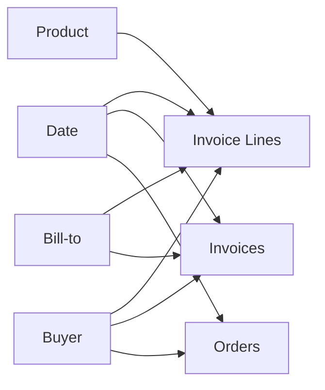

# Power BI Sales Analytics

Open the active [RetailSalesAnalytics.pbip](RetailSalesAnalytics/RetailSalesAnalytics.pbip) in Power BI Desktop. Its Report, SemanticModel and registered resources are the tracked source of truth. Preserve hidden detail pages, DAX, themes and assets. The owner's original `Sales_Dashboard.pbix` and imported caches are local backups excluded from Git. See the [project overview](../README.md).

## Connection and Manual Refresh

| Setting | Value |
|---|---|
| Connector / mode | PostgreSQL / Import |
| Server | `127.0.0.1:55434` |
| Database / authentication | `retail_raw` / Database |
| User | `retail_bi_reader` |
| Current expected read version | `3a2f011d-f3b3-5683-83a2-a64837720f3d` |

Enter the private role password in Desktop Data Source Settings; it is not stored in tracked model files. Do not share passwords in chat, SQL files or command history. For authentication failure, verify the endpoint, saved credential scope and actual role login before changing anything. Do not substitute ingestion/admin credentials.

Refresh only after a successful warehouse build and mart/KPI validation, with no active writer. Open the main PBIP, select **Refresh**, verify version/counts/measures and save the local imported cache. Airflow completion does not mean BI refresh completion. There is no Power BI REST API refresh or automatic version-pin update.

The reader has CONNECT, schema USAGE and SELECT on exactly these 12 objects:

| Schema | Approved objects |
|---|---|
| `dw_core` | `dim_date`, `dim_customer`, `dim_product`, `fact_invoice_line`, `fact_order_line` |
| `dw_intermediate` | `int_invoice_header`, `int_order_header` |
| `sales_marts` | `mart_sales_daily`, `mart_sales_monthly`, `mart_sales_product_daily`, `mart_customer_sales`, `mart_sales_customer_summary` |

No Raw, staging, DQ, ingestion metadata or test access is granted. [Infrastructure setup](../infrastructure/README.md) covers provisioning and interactive password handling. [Model-level dbt grants](../dbt/dbt_project.yml) preserve SELECT after rebuilds without broad default grants.

## Dashboard Pages

| Main page | Questions and visuals |
|---|---|
| Sales Performance | Sales, invoices, AIV and units; monthly Sales/PY trend and volume/AIV timeline |
| Product Contribution | Product concentration and Pareto curve with an 80% reference; Top N sales/unit rankings |
| Sales Attribution | Buyer versus Bill-to concentration and comparable percentage bars; the same Sales viewed by role |
| Exceptions & Coverage | Negative source LineProfit warnings, monthly rates and weekday activity including zero-transaction Sundays |

Four hidden detail pages cover monthly Sales, product exploration, customer roles and source diagnostics. Explore details is page navigation; drill-through requires matching fields and context. Customer drill-through is declared on Buyer customer name, not a universal Bill-to target.

Year/Date slicers synchronize across main/detail pages. Product sync applies to its overview/detail pair; Top N is shared by Product/Attribution while Top 5 cards remain fixed Top 5. The role selector controls customer detail, not enterprise Sales. Reset uses ClearAllSlicers, not bookmark restoration or guaranteed removal of external/drill-through context. Pareto ranks do not cross-filter Top N bars; Buyer/Bill-to overview charts do not cross-filter each other.

## Import Tables and Model

| Model table | PostgreSQL source | Grain / source rows at current version |
|---|---|---|
| Date | `dw_core.dim_date` | Calendar day / 1,247 |
| Product | `dw_core.dim_product` | Observed product / 227 |
| Buyer | `dw_core.dim_customer` | Observed customer / 663 |
| Invoice Lines | `dw_core.fact_invoice_line` | InvoiceLineID / 228,265 |
| Invoices | `dw_intermediate.int_invoice_header` | InvoiceID / 70,510 |
| Orders | `dw_intermediate.int_order_header` | OrderID / 73,595 |

Only these six objects are imported. Marts and the order-line fact are independently available for SQL reconciliation, not additional additive report populations. Customer daily/summary marts currently contain BUYER rows only.

Eight calculated tables complete the 14-table model: Bill-to (role-playing Buyer copy), Attribution Customer (disconnected axis), Metrics, Top N, Role, Ranking Basis, Concentration Rank and Decomposition. [Metrics.tmdl](RetailSalesAnalytics/RetailSalesAnalytics.SemanticModel/definition/tables/Metrics.tmdl) contains 87 DAX measures.

Nine active many-to-one relationships filter in a single direction from dimensions:

There are no fact-to-fact, bidirectional or many-to-many joins. Customer/Product references are observed-current labels, not proven transaction-time SCD2. Bill-to uses invoice-time role keys rather than reassigning old invoices from the current customer master. Attribution measures remove the other role's filter as required; **never add Buyer and Bill-to totals**.

## Measures and Interpretation

[Approved measure YAML](../dbt/config/measures.yml) and [validation.sql](validation.sql) define reproducible SQL comparisons.

| Measure | Scope / behavior |
|---|---|
| Sales Before Tax | Eligible invoice lines: ExtendedPrice − TaxAmount, by InvoiceDate |
| Invoice Count | Eligible invoice headers; Product filtering uses a distinct invoice-ID semijoin |
| Order Count | Eligible Orders by OrderDate, including orders without invoices; does not apply Product filter |
| AIV | Sales / Invoice Count, ratio of totals; zero denominator returns BLANK |
| Units | Sum eligible source Quantity; not normalized across packaging |
| YoY / previous period | Comparable selected dates; guards reject unsupported multi-year/multi-month total contexts |

The calendar has 1,247 continuous days from 2013-01-01 to 2016-05-31. Compare 2016 January–May with the same prior-year dates, not all of 2015. PY shifts selected days 12 months; leap-day mapping removes duplicate prior dates. YTD uses the selected-data cutoff, not the computer's current year. Decomposition requires suitable single-year/prior context and explains arithmetic components, not causality.

Ranking uses the selected population with deterministic SKU tie-breaking. Lifetime and latest-captured-year YTD ranks have different scopes. Top N ranges from 5–50 with a measure default of 10; percentages and overlapping distinct counts cannot be added. Zero overlap is different from no eligible population.

Money is imported as fixed four-decimal values, without inventing USD/BRL/VND. AIV converts to Double before division to avoid premature fixed-decimal rounding. Decomposition components round to cents, with interaction carrying the residual. NULL/BLANK is not silently converted to zero. Technical fields and fact/header tables are hidden from report authoring. Negative source LineProfit is a warning, not certified accounting loss; uninvoiced orders do not prove fulfillment failure.

## Read-Version Pin

There is no shared Power Query version parameter. Each of the six import partitions has a `Pinned` step that checks the entire source table contains exactly one `_capture_id`, equal to the expected UUID. Mixed/wrong versions fail refresh rather than being hidden by a UUID filter.

For a separately reviewed version change:

1. Verify the candidate ledger is VALIDATED, lineage/contracts are eligible and all 12 serving objects consistently use the target version; reconcile SQL KPIs.
2. Pause/drain writers and verify reader permissions. Update all six TMDL guards together, plus expected-version assertions in [test_project.py](tests/test_project.py), [validate_sql.py](validate_sql.py) and [validation.sql](validation.sql).
3. Reload externally changed definitions in Desktop, refresh, compare SQL/DAX counts and measures, inspect visuals and save the imported cache.

Do not remove guards, choose latest automatically or treat an old imported cache as current after a new dbt build. The current local version is validated with ACK=NULL, not a Certified or atomically published release.

## Validation and Limitations

The accepted version sync verified six imports, SQL/DAX totals and rendered all eight pages. All-period values are Sales 172,261,341.20; Tax 25,782,098.25; Including Tax 198,043,439.45; Units 8,950,628; Invoices 70,510; Orders 73,595. These are historical runtime results; a structural check does not refresh the model or prove all future filter contexts.

[query_model.ps1](query_model.ps1), [dax-validation-queries.json](dax-validation-queries.json), [export_model_metadata.ps1](export_model_metadata.ps1) and SQL validation utilities support controlled local checks with a verified Desktop PID and private outputs. Offline project tests run through `.venv\Scripts\python.exe scripts/run_checks.py`.

Complete click/navigation/sync/reset/drill-through/tooltip acceptance remains outstanding. Structural validation and screenshots are not a substitute. Keep the existing report/assets intact; do not regenerate the dashboard to troubleshoot credentials or change warehouse/KPI logic from the BI layer.
