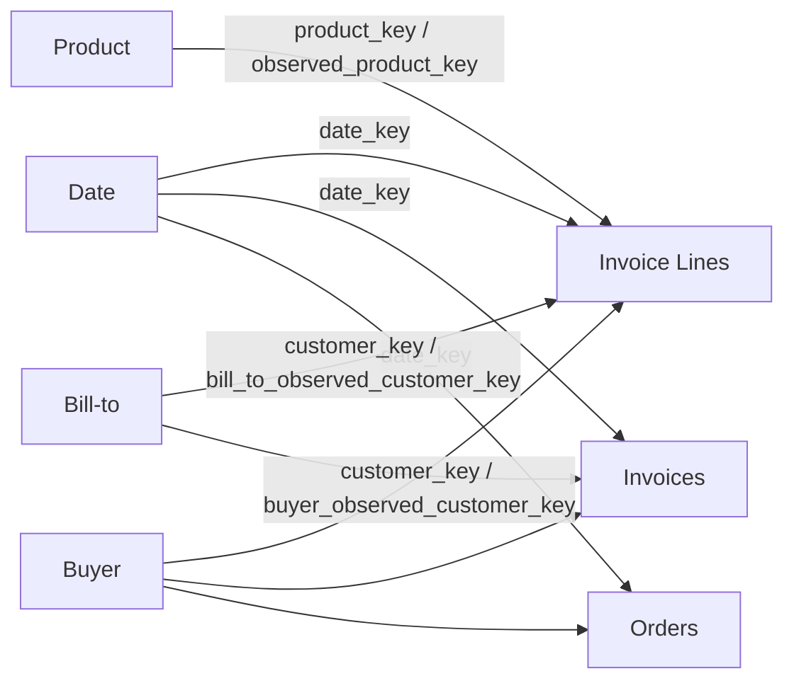

# Power BI Sales Analytics

Mở [RetailSalesAnalytics.pbip](RetailSalesAnalytics/RetailSalesAnalytics.pbip) bằng Power BI Desktop. Active .Report/.SemanticModel/TMDL và RegisteredResources là source of truth; không dựng lại bằng generator hoặc xóa hidden pages/assets. Original Sales_Dashboard.pbix là backup Owner, giữ nguyên và không commit imported-data cache.

## Kết nối và refresh

PostgreSQL:127.0.0.1:55434, retail_raw, Database authentication bằng retail_bi_reader. Nhập password từ private local profile vào Desktop, không gửi vào chat/SQL file/Git. Nếu lỗi: xác minh Docker Engine/container/port, Data Source Settings đúng endpoint và credential; không đổi role/password hoặcsecurity settings tự động.

Sau khi serving models đã build/reconcile vàđúng version: mở bản chính, chọn Refresh, xác minh version/counts/KPI rồi Save. Không refresh nhầm bản .local/reopen-check; không chạy ingestion/dbt build tự động để sửa report. Access role đọc12 objects: dw_core.dim_date/dim_customer/dim_product/fact_invoice_line/fact_order_line, dw_intermediate.int_invoice_header/int_order_header, sales_marts.mart_sales_daily/mart_sales_monthly/mart_sales_product_daily/mart_customer_sales/mart_sales_customer_summary. Không được Raw/staging/DQ/meta/test access.

Provisioning role trong infrastructure/postgres/warehouse/provision_bi_reader.sql cần admin approval, password qua psql password prompt, không hardcode. Model-level dbt grants giữ SELECT sau rebuild; không dùng folder/project grants hoặc cấp db_datareader/admin để giải quyết lỗi truy cập.

## Dashboard và filters

| Trang chính | Nội dung |
|---|---|
| Sales Performance | Bốn KPI Sales/Invoices/AIV/Units; monthly Sales/PY trend lớn và volume/AIV cùng timeline. Monthly matrix/decomposition ở Explore details. |
| Product Contribution | Pareto theo rank số/đường 80%, hai TopN bars. Ranking matrix và scatter ở detail. |
| Sales Attribution | Concentration curve chủ đạo; hai bars có cùng trục 0–100% và nhãn tỷ trọng. Đây là cùng Sales theo hai roles, không cộng. |
| Exceptions & Coverage | Warning concentration, monthly count/rate, clustered weekday counts đủ Sunday. Không gọi negative LineProfit là certified accounting loss. |

## Filter và navigation

- Year/Date đồng bộ giữa bốn main pages và detail. Product chỉ đồng bộ Product overview/detail. TopN đồng bộ Product/Attribution; Top5 cards luôn là Top5.
- Attribution role ở Customer Roles detail, điều khiển matrix. Hai role charts overview luôn độc lập để so sánh, không bị role selector làm mất một phía.
- Explore details là page navigation; không đồng nghĩa với truyền data-point filter. Drill-through context menu chỉ áp dụng khi visual có field phù hợp. Monthly detail nhận Date.month_start; Product detail nhận Product.stock_item_name. Customer detail khai báo theo Buyer.customer_name; không khẳng định mọi Bill-to point có cùng drill target. Back trả về selection nguồn.
- Reset filters dùng ClearAllSlicers, không restore bookmark defaults. Sync group có thể làm date/TopN ở trang khác đổi theo. Không hứa reset xóa mọi external/drill-through filter.
- Chart selection cấu hình DataFilter giữa các charts thông thường; Pareto numeric-rank axis không lọc TopN bars, các charts Buyer/Bill-to không lọc chéo nhau. Tooltips giữ context. Các hành vi click thực tế còn chờ kiểm thử.

## Cách đọc

2016 chỉ có January–May. PY dịch cùng các ngày đang chọn lùi 12 tháng; không so full2016 với full2015. Decomposition cần một calendar year; BLANK khi nhiều năm là guard có chủ đích. Trend vẫn hiển thị monthly comparisons qua nhiều năm.

Sales là invoiced sales before tax theo InvoiceDate; không tự gọi recognized revenue/net profit. Chưa có currency contract để gắn USD/BRL/VND. Units là source quantity, không bảo đảm cùng packaging. AIV là ratio của totals, không phải trung bình AIV con.

Ranks dùng product selection hiện hành. Lifetime bỏ Date filter; latest captured YTD dùng năm cuối dữ liệu, không phải năm máy. Zero overlap khác empty population. Zero-transaction Sundays không phải missing calendar dates. Order chưa direct invoice không mặc nhiên fulfillment failure; BackorderOrderID chưa mở rộng vào model.

## Imports và grain

| Model table | PostgreSQL object | Grain | Rows nguồn đã kiểm tra |
|---|---|---|---:|
| Date | dw_core.dim_date | Một ngày lịch/version | 1247 |
| Product | dw_core.dim_product | Một observed Product/version | 227 |
| Buyer | dw_core.dim_customer | Một observed Customer/version | 663 |
| Invoice Lines | dw_core.fact_invoice_line | Một InvoiceLineID/version | 228265 |
| Invoices | dw_intermediate.int_invoice_header | Một InvoiceID/version | 70510 |
| Orders | dw_intermediate.int_order_header | Một OrderID/version | 73595 |

Không import order-line fact/marts để tránh dữ liệu dư và các joins khác grain. Marts vẫn được đọc riêng qua reader cho SQL reconciliation, không cộng với facts. Customer daily mart là InvoiceDate/customer/role (66463 rows), summary là customer/role (663 rows), không coi daily mart unique theo customer. Hai marts này hiện chỉ BUYER.

Calculated tables: Bill-to (role-playing copy của Buyer), Attribution Customer (disconnected axis), Metrics, Top N, Role, Ranking Basis, Concentration Rank, Decomposition. Tổng 14 model tables, chỉ 6 PostgreSQL imports. Các parameter constants và ngưỡng Pareto là cấu hình phân tích, không phải KPI hardcoded.

## Relationships

9 quan hệ active, many-to-one, single direction từ dimensions xuống headers/fact:

Không fact-to-fact, bidirectional hoặc many-to-many join. Thay auto relationship sai `source_business_key` Customer ↔ InvoiceLine trong PBIX ban đầu. Chỉ dùng **observed** customer/product keys; không join historical keys đang NULL/U, không tự giải quyết SCD2. Nhãn Customer/Product là observed-current, không phải nhãn tại ngày giao dịch.

Bill-to lấy invoice-time role key, không dùng current_bill_to_customer_id để gán lại invoice cũ. Buyer và Bill-to Sales cùng một doanh số; measures attribution bỏ filter của role còn lại, tuyệt đối không cộng hai totals. Role selector mặc định Buyer; chỉ điều khiển detail attribution, không đổi enterprise Sales.

## Measures, dates và types

[87 DAX measures](RetailSalesAnalytics/RetailSalesAnalytics.SemanticModel/definition/tables/Metrics.tmdl), [DAX dễ đọc](../README.md). Sales/tax/including-tax/quantity theo eligible invoice lines; WARNING giữ lại. Invoice Count theo eligible **Invoices**, Product filter dùng distinct invoice-ID semijoin. Order Count theo **Orders/OrderDate**, giữ order chưa invoice và không áp Product filter. AIV = Sales / Invoice Count, tính lại ratio theo context; zero denominator → BLANK.

Date có 1247 ngày liên tục 2013-01-01–2016-05-31, `calendar_date` kiểu dateTime/isKey, table category Time; Year–Quarter–Month hierarchy, Year Month sort YYYYMM, weekday sort ISO. Auto date tables tắt bằng model annotation. Calendar year, không tự đặt fiscal calendar.

YoY chỉ trả khi context một năm; ngày chọn dịch 12 tháng và giữ non-date filters. 2016 chỉ Jan–May, không so với cả 2015. Feb 29 ánh xạ Feb 28 năm trước và loại ngày trùng qua TREATAS. Previous Period/MoM chỉ tại single year-month; multi-month tổng → BLANK. YTD dùng cutoff MAX ngày đang chọn, không TODAY năm 2026. Decomposition gồm deltaN*A0 + N0*deltaA + deltaN*deltaA; thiếu prior context → BLANK, không suy nguyên nhân kinh doanh.

Pareto/rank dùng selected product population, tie-break SKU ID; top20% làm tròn lên. Lifetime và latest captured year YTD ranks là hai scope được ghi rõ. Rank basis selector chỉ điều khiển cột selected metric rank ở detail; hai TopN charts vẫn cùng selected dates. TopN 5–50, mặc định measure 10. Customer concentration denominator cùng dates/Product/role, không cộng percentages hoặc overlapping distinct counts.

Money chuyển `Currency.Type`/TOM decimal (fixed 4 digits), không gắn mã tiền tệ chưa được xác nhận. IDs/quantities int64; NULL giữ nguyên. Fixed-decimal type không có nghĩa đã xác nhận currency. Technical keys/version metadata ẩn, facts/headers ẩn khỏi authoring, measures có display folders/descriptions. Source timestamps lịch sử không được biến thành business-effective time.

PQuery chỉ navigation đúng 6 approved objects tại `127.0.0.1:55434/retail_raw`, kiểm một `_capture_id` đúng `3a2f011d-f3b3-5683-83a2-a64837720f3d`; credential nhập bằng Database authentication `retail_bi_reader`, không nằm trong model files. PBIP model root name và lineage tags của reused tables/columns được giữ từ bản Owner; các role/parameter objects mới có deterministic IDs.

Model hiện chưa có shared Power Query version parameter. Pin nằm trong bước `Pinned` của sáu import partitions (Date/Product/Buyer/Invoice Lines/Invoices/Orders): kiểm toàn bộ bảng có duy nhất một version đúng kỳ vọng, sai thì dừng refresh. Đổi pin phải xác minh ledger VALIDATED, lineage/contract và version của cả 12 serving objects trước; sau đó cập nhật đồng bộ sáu guards cùng expected pin trong test_project.py/validate_sql.py/validation.sql. Không dùng filter UUID để che mixed versions, bỏ guard hoặc tự lấy latest. Reload model definitions trước Refresh nếu Desktop đang mở khi sửa TMDL.

POWERBI-VERSION-SYNC-01 (23/11/2026): chuyển từ `c825b18e-fc62-4cf1-8837-b37b4c9f9668` sang version trên. Đã refresh thật bằng TOM trong Desktop và truy vấn DAX xác nhận cả sáu bảng import đúng pin/count; 15 truy vấn DAX trước/sau khớp nhau, đối soát SQL với core/headers/marts đạt, render đủ tám trang có dữ liệu. Tổng toàn kỳ: Sales 172261341.20, Tax 25782098.25, IncludingTax 198043439.45, Units 8950628, Invoices 70510, Orders 73595, AIV 2443.0767437242944. Layout/DAX/theme/assets giữ nguyên; metadata ingestion/capture/checkpoint/publication không đổi. Đây là version local development đã VALIDATED, ACK=NULL; không nâng thành Certified/operational publication. Cache và runtime evidence ở ignored .local/powerbi-version-sync-01, không commit. Khi đóng Desktop, Save để lưu imported cache cục bộ; source definitions trong Git không chứa cache.

## Validation và giới hạn

Model có14tables,9relationships,87measures; bốn trang chính vàbốn detail. Kiểm tra DAX bằng dax-validation-queries.json/query_model.ps1 với đúng Desktop PID và output private trong.local; validate_sql.py/validation.sql đối soát SELECT độc lập. Tests dùng TOM kèm Desktop và fixtures trong tests/fixtures. SQL/DAX137checks là kết quả từng thực thi, không tự là PASS cho mọi future filter/version.

Giữ source money fixed decimal; AIV cast sangDouble trước DIVIDE để tránh rounding sớm. Decomposition Volume/AIV làm tròn đến xu; Interaction nhận monetary delta trừ hai components, gồm rounding residue. Không diễn giải component như causality. BLANK khi không có prior/eligible population là guard, không biến missing data thành0. Overlap empty intersection có population trả0. Ranking loại attributed customer BLANK/0; product ranks trong selection.

Không cộng Buyer vàBill-to; không gọi Sales recognized revenue hoặc negative source LineProfit là accounting loss. Chưa gắn currency chưa xác nhận. Lifetime ranks khác comparable YTD;2016chỉJan–May. UI click/navigation/reset/sync/drill-through/tooltips chưa nghiệm thu đầy đủ; structural tests/render screenshots không thay thao tác UI. Serving local chưa Certified/atomic publication. Parse/runtime smoke cần Docker/SQL kết nối được.
