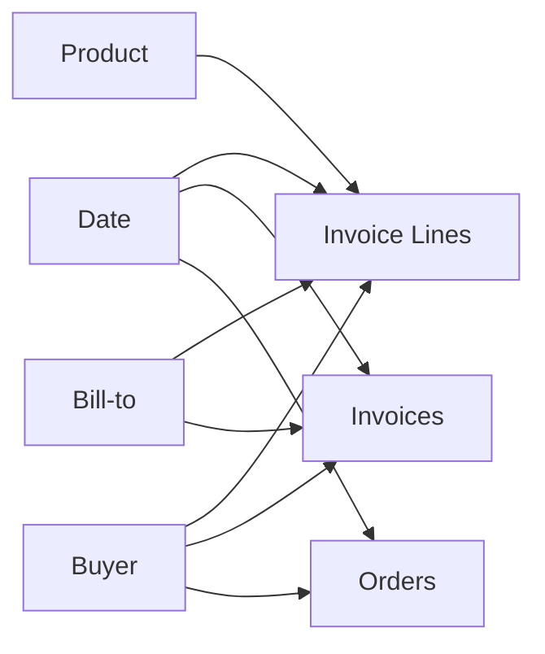
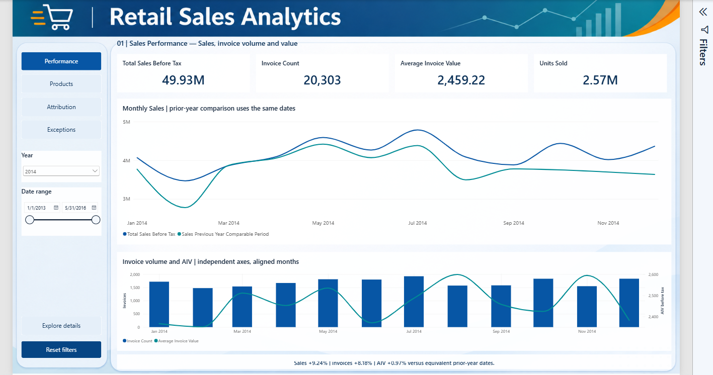
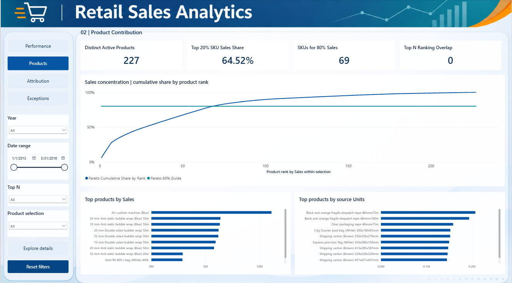

# Power BI Sales Analytics

## Overview

Power BI is the analytics consumption layer for the Sales Data Warehouse. The report supports sales trends, product contribution, Buyer/Bill-to attribution and coverage/exception analysis through four main pages and four detail pages.

Open [RetailSalesAnalytics.pbip](RetailSalesAnalytics/RetailSalesAnalytics.pbip) in Power BI Desktop. The tracked Report, SemanticModel and registered resources define the project. Imported caches and binary PBIX backups remain outside Git. See the [project overview](../README.md).

## Data Sources

The semantic model uses Power BI Import from six PostgreSQL objects:

| Model table | Source | Grain | Reference row count |
|---|---|---|---:|
| Date | `dw_core.dim_date` | Calendar day | 1,247 |
| Product | `dw_core.dim_product` | Observed product | 227 |
| Buyer | `dw_core.dim_customer` | Observed customer | 663 |
| Invoice Lines | `dw_core.fact_invoice_line` | InvoiceLineID | 228,265 |
| Invoices | `dw_intermediate.int_invoice_header` | InvoiceID | 70,510 |
| Orders | `dw_intermediate.int_order_header` | OrderID | 73,595 |

These counts describe the pinned reference dataset. Marts and `fact_order_line` support independent SQL analysis/reconciliation; they are not extra additive report populations.

The `retail_bi_reader` role has CONNECT, USAGE and SELECT on exactly 12 serving objects: the six imports above, `dw_core.fact_order_line`, and `sales_marts.mart_sales_daily`, `mart_sales_monthly`, `mart_sales_product_daily`, `mart_customer_sales`, `mart_sales_customer_summary`. It has no Raw, staging, DQ, ingestion metadata or test access. [Infrastructure](../infrastructure/README.md#database-roles-and-permissions) describes provisioning, while [model grants](../dbt/dbt_project.yml) preserve access after replacement.

## Semantic Model

The model contains 14 tables and 87 DAX measures. Eight calculated tables complement the six imports: Bill-to (a role-playing Buyer copy), Attribution Customer (a disconnected axis), Metrics, Top N, Role, Ranking Basis, Concentration Rank and Decomposition.

Customer/Product attributes are observed-current labels rather than complete transaction-time SCD Type 2 attributes. Bill-to uses invoice-time role keys, not reassignment from the current customer master. Customer marts currently contain BUYER attribution only; report Bill-to measures use the invoice role keys.

## Report Pages

| Main page | Business questions |
|---|---|
| Sales Performance | How do Sales, invoices, AIV and units change across comparable periods? |
| Product Contribution | Which products contribute Sales/units, and how concentrated are those contributions? |
| Sales Attribution | How does customer concentration differ between Buyer and Bill-to roles? |
| Exceptions & Coverage | Where do negative source LineProfit warnings, zero activity and date coverage affect interpretation? |

Four hidden detail pages cover monthly Sales, product exploration, customer roles and source diagnostics. Explore details uses page navigation. Drill-through requires a matching field/context; customer drill-through is declared on Buyer customer name, not a universal Bill-to target.

## Business KPIs

[Measure definitions](../dbt/config/measures.yml) and [validation SQL](validation.sql) define the reporting populations.

| KPI | Definition and filter behavior |
|---|---|
| Sales Before Tax | Sum ExtendedPrice − TaxAmount on eligible invoice lines, by InvoiceDate |
| Invoice Count | Eligible invoice headers; Product filtering uses a distinct invoice-ID semijoin |
| Order Count | Eligible Orders by OrderDate, including orders without invoices; Product filtering does not apply |
| Average Invoice Value | Sales / Invoice Count, ratio of totals; zero denominator returns BLANK |
| Source Units Sold | Sum eligible Quantity without normalization across packaging |
| YoY / previous period | Comparable selected dates, with guards for unsupported multi-year/month totals |

The reference dataset spans 2013-01-01 through 2016-05-31. Its all-period totals are Sales Before Tax 172,261,341.20; Tax 25,782,098.25; Including Tax 198,043,439.45; Units 8,950,628; Invoices 70,510; Orders 73,595. [Aggregate evidence](../docs/assets/sales-evidence.json) connects the [business insights](../README.md#business-insights) to SQL queries Q02/Q05/Q08/Q09.

Sales do not imply recognized accounting revenue, and source LineProfit is not certified accounting profit/loss. Uninvoiced orders do not establish fulfillment failure. Buyer and Bill-to totals describe the same sale and must not be added.

## DAX Measures

[Metrics.tmdl](RetailSalesAnalytics/RetailSalesAnalytics.SemanticModel/definition/tables/Metrics.tmdl) defines the 87 measures, including comparable-period calculations, rankings, concentration and arithmetic volume/value decomposition.

Compare 2016 January–May with the same prior-year dates rather than the whole of 2015. Previous-year calculations shift selected days by 12 months and deduplicate leap-day mappings. YTD uses the selected-data cutoff, not the machine's current year. Decomposition needs suitable single-year/prior context and explains arithmetic components, not causality.

Ranking uses the selected population with deterministic SKU tie-breaking. Lifetime and latest-captured-year YTD rankings have different scopes. Top N ranges from 5–50 with a measure default of 10. Percentages and overlapping distinct counts are not additive; zero overlap differs from no eligible population.

Money imports use fixed four-decimal values without assigning USD, BRL or VND. AIV converts to Double before division to avoid premature fixed-decimal rounding. Decomposition components round to cents, with the interaction component carrying the residual. NULL/BLANK is not silently converted to zero.

## Relationships and Filters

Nine active many-to-one relationships filter in a single direction from Dimensions:

There are no fact-to-fact, bidirectional or many-to-many relationships. Attribution measures remove the other role's filter as required. Technical fields and fact/header tables are hidden from report authoring.

Year/Date slicers synchronize across main/detail pages. Product synchronization applies to its overview/detail pair. Top N is shared by Product/Attribution, while Top 5 cards remain fixed. The role selector controls customer detail rather than enterprise Sales.

Reset uses ClearAllSlicers, not bookmark restoration or guaranteed removal of external/drill-through context. Pareto ranks do not cross-filter Top N bars; Buyer and Bill-to overview charts do not cross-filter one another.

## Dashboard Screenshots

Sales Performance with 2014 selected.

Product Contribution with 2014 and Top N=5 selected. These views have a different scope from the all-period KPI totals and January–May comparisons. [Image provenance](../docs/assets/provenance.json) records hashes and filter context.

## Refreshing Data

Power BI Import uses Manual Refresh independently of Airflow. Begin only after the warehouse graph completes validation, all 12 serving objects use the intended Read Version and no writer or Windows child is active. Pause/drain any pre-armed pipeline run to keep the refresh window stable.

Open the main PBIP, authenticate through Data Source Settings, select Refresh, verify imported versions/counts/measures and save the local cache. An existing imported cache does not identify the current warehouse version. There is no automatic Power BI REST refresh or automatic version-pin update.

### Read Version Pin

Each of the six import partitions has a `Pinned` step requiring exactly one `_capture_id` across the whole source table and a match to the expected UUID. Mixed/wrong versions fail refresh rather than being hidden by a UUID filter. There is no shared Power Query version parameter.

To change the expected version:

1. Verify a VALIDATED candidate, eligible lineage/contracts, consistent target identity on all 12 serving objects and reconciled SQL KPIs.
2. Pause/drain writers and verify reader access. Update all six TMDL guards together, plus expected-version assertions in [test_project.py](tests/test_project.py), [validate_sql.py](validate_sql.py) and [validation.sql](validation.sql).
3. Reload the changed definitions in Desktop, refresh, compare SQL/DAX counts and measures, inspect visuals and save.

Retain all guards and explicit version selection. Candidate validation with ACK=NULL is distinct from Certified or atomically published data.

## Data Validation

[query_model.ps1](query_model.ps1), [dax-validation-queries.json](dax-validation-queries.json), [export_model_metadata.ps1](export_model_metadata.ps1) and SQL utilities support controlled comparisons using a verified Desktop PID and private output files. Compare SQL and DAX at the same Read Version, grain, role and filter scope.

`python scripts/run_checks.py` includes offline Power BI structure tests using Windows/Desktop TOM. The portable suite excludes those Desktop-dependent checks. Structural checks do not refresh data or exercise every visual interaction.

## Configuration

| Setting | Value |
|---|---|
| Connector / mode | PostgreSQL / Import |
| Server | `127.0.0.1:55434` |
| Database / authentication | `retail_raw` / Database |
| User | `retail_bi_reader` |
| Expected Read Version | `3a2f011d-f3b3-5683-83a2-a64837720f3d` |

Enter the private reader password in Desktop Data Source Settings; credentials are not tracked in the semantic model. For authentication errors, inspect endpoint, saved credential scope and role login rather than substituting ingestion/admin credentials. Keep credentials out of Git, SQL literals, command history and shared logs.

## Limitations

The fixed six-import pin and Manual Refresh require deliberate coordination with warehouse replacement. Observed-current labels do not provide historical SCD Type 2 attribution, and source units/currency/accounting interpretations remain bounded by the measure contract. Full navigation, synchronization, reset, drill-through and tooltip behavior still requires end-to-end interaction checks; structural checks and screenshots cover narrower aspects of the report.
