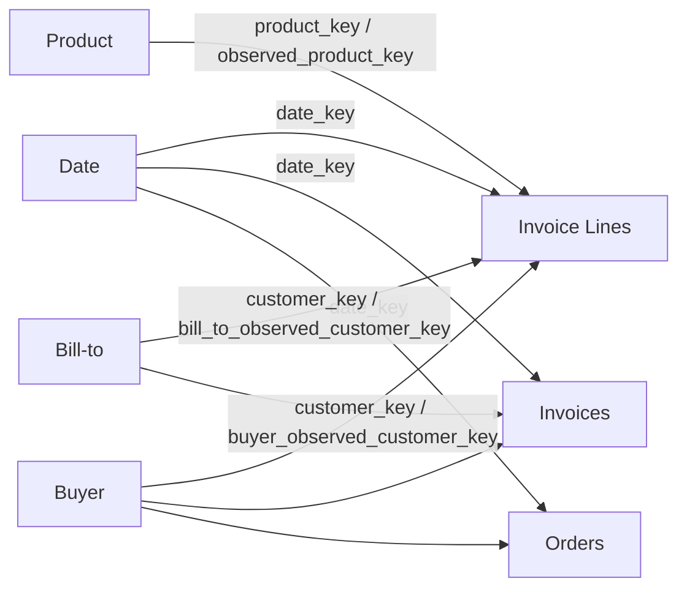

# Semantic model — POWERBI-SALES-01

**Current: POWERBI-UX-REDESIGN-01.** [Model TMDL](RetailSalesAnalytics/RetailSalesAnalytics.SemanticModel/definition/) là nguồn hiện hành sau chuyển đổi đã lưu của Owner. Live model có 14 tables Ready, 9 relationships, 87 measures; [137 SQL/DAX checks PASS](dashboard-guide.md). Giữ sáu imports và version đã nghiệm thu. NoData/model.bim trong báo cáo cũ là trạng thái lịch sử.

AIV vẫn là Sales/Invoice Count cùng scope, nhưng cast tử số sang Double trước phép chia để tránh làm tròn sớm. Monetary source columns vẫn fixed decimal. Volume/AIV contributions làm tròn đến xu; Interaction bằng monetary Sales delta trừ hai component đó và nhận phần bù rounding. Đây là cùng identity ba thành phần, không suy diễn nguyên nhân kinh doanh. Rank Buyer/Bill-to/Selected Role loại attributed Sales BLANK/0. Overlap trả 0 cho giao rỗng có population, giữ BLANK khi không có population. Thêm 10 UX helpers, không thêm bảng/import. [Evidence và giới hạn](dashboard-guide.md).

## Imports và grain

| Model table | PostgreSQL object | Grain | Rows nguồn đã kiểm tra |
|---|---|---|---:|
| Date | dw_core.dim_date | Một ngày lịch/version | 1247 |
| Product | dw_core.dim_product | Một observed Product/version | 227 |
| Buyer | dw_core.dim_customer | Một observed Customer/version | 663 |
| Invoice Lines | dw_core.fact_invoice_line | Một InvoiceLineID/version | 228265 |
| Invoices | dw_intermediate.int_invoice_header | Một InvoiceID/version | 70510 |
| Orders | dw_intermediate.int_order_header | Một OrderID/version | 73595 |

Không import order-line fact/marts để tránh dữ liệu dư và các joins khác grain. Marts vẫn được đọc riêng qua reader cho SQL reconciliation, không cộng với facts. Customer daily mart là InvoiceDate/customer/role (66463 rows), summary là customer/role (663 rows), không coi daily mart unique theo customer. Hai marts này hiện chỉ BUYER.

Calculated tables: Bill-to (role-playing copy của Buyer), Attribution Customer (disconnected axis), Metrics, Top N, Role, Ranking Basis, Concentration Rank, Decomposition. Tổng 14 model tables, chỉ 6 PostgreSQL imports. Các parameter constants và ngưỡng Pareto là cấu hình phân tích, không phải KPI hardcoded.

## Relationships

9 quan hệ active, many-to-one, single direction từ dimensions xuống headers/fact:

Không fact-to-fact, bidirectional hoặc many-to-many join. Thay auto relationship sai `source_business_key` Customer ↔ InvoiceLine trong PBIX ban đầu. Chỉ dùng **observed** customer/product keys; không join historical keys đang NULL/U, không tự giải quyết SCD2. Nhãn Customer/Product là observed-current, không phải nhãn tại ngày giao dịch.

Bill-to lấy invoice-time role key, không dùng current_bill_to_customer_id để gán lại invoice cũ. Buyer và Bill-to Sales cùng một doanh số; measures attribution bỏ filter của role còn lại, tuyệt đối không cộng hai totals. Role selector mặc định Buyer; chỉ điều khiển detail attribution, không đổi enterprise Sales.

## Measures, dates và types

[87 measures](dashboard-guide.md), [DAX dễ đọc](dashboard-guide.md). Sales/tax/including-tax/quantity theo eligible invoice lines; WARNING giữ lại. Invoice Count theo eligible **Invoices**, Product filter dùng distinct invoice-ID semijoin. Order Count theo **Orders/OrderDate**, giữ order chưa invoice và không áp Product filter. AIV = Sales / Invoice Count, tính lại ratio theo context; zero denominator → BLANK.

Date có 1247 ngày liên tục 2013-01-01–2016-05-31, `calendar_date` kiểu dateTime/isKey, table category Time; Year–Quarter–Month hierarchy, Year Month sort YYYYMM, weekday sort ISO. Auto date tables tắt bằng model annotation. Calendar year, không tự đặt fiscal calendar.

YoY chỉ trả khi context một năm; ngày chọn dịch 12 tháng và giữ non-date filters. 2016 chỉ Jan–May, không so với cả 2015. Feb 29 ánh xạ Feb 28 năm trước và loại ngày trùng qua TREATAS. Previous Period/MoM chỉ tại single year-month; multi-month tổng → BLANK. YTD dùng cutoff MAX ngày đang chọn, không TODAY năm 2026. Decomposition gồm deltaN*A0 + N0*deltaA + deltaN*deltaA; thiếu prior context → BLANK, không suy nguyên nhân kinh doanh.

Pareto/rank dùng selected product population, tie-break SKU ID; top20% làm tròn lên. Lifetime và latest captured year YTD ranks là hai scope được ghi rõ. Rank basis selector chỉ điều khiển cột selected metric rank ở detail; hai TopN charts vẫn cùng selected dates. TopN 5–50, mặc định measure 10. Customer concentration denominator cùng dates/Product/role, không cộng percentages hoặc overlapping distinct counts.

Money chuyển `Currency.Type`/TOM decimal (fixed 4 digits), không gắn mã tiền tệ chưa được xác nhận. IDs/quantities int64; NULL giữ nguyên. Fixed-decimal type không có nghĩa đã xác nhận currency. Technical keys/version metadata ẩn, facts/headers ẩn khỏi authoring, measures có display folders/descriptions. Source timestamps lịch sử không được biến thành business-effective time.

PQuery chỉ navigation đúng 6 approved objects tại `127.0.0.1:55434/retail_raw`, kiểm một `_capture_id` đúng c825b18e-fc62-4cf1-8837-b37b4c9f9668; credential nhập bằng Database authentication `retail_bi_reader`, không nằm trong model files. PBIP model root name và lineage tags của reused tables/columns được giữ từ bản Owner; các role/parameter objects mới có deterministic IDs.
